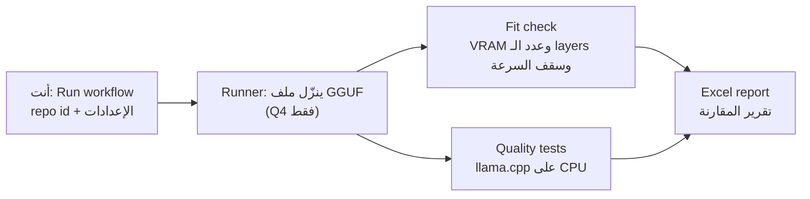
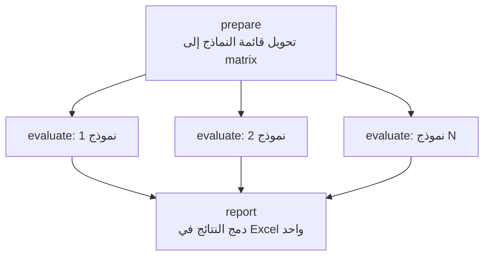
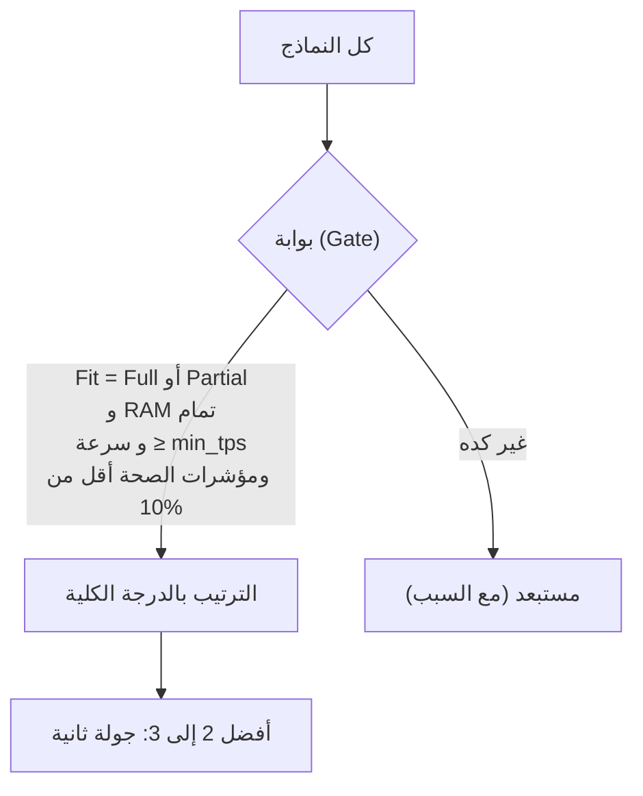
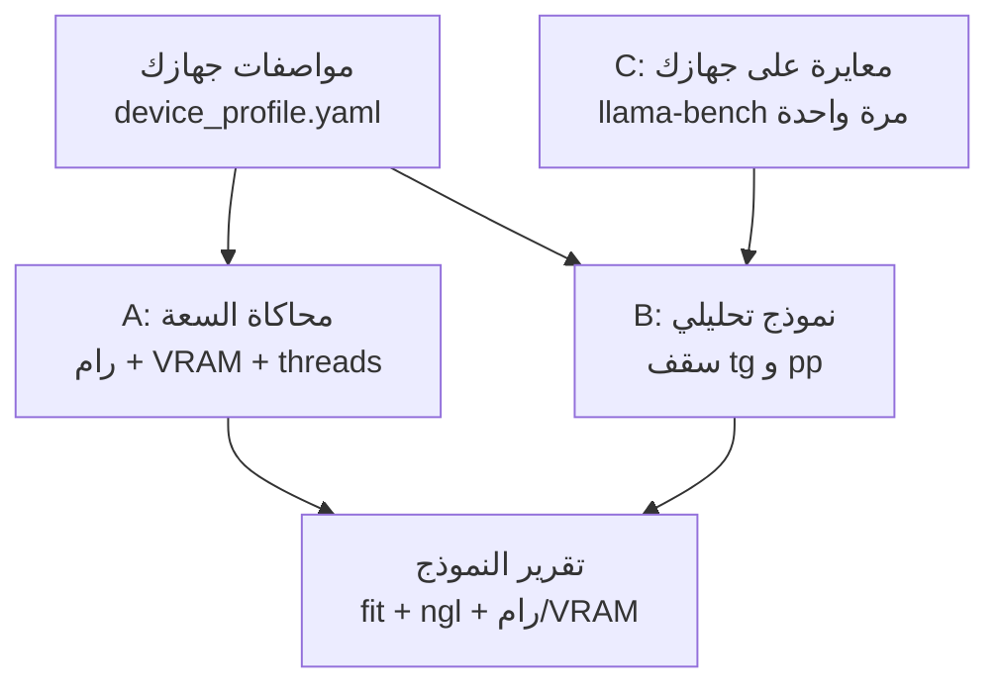
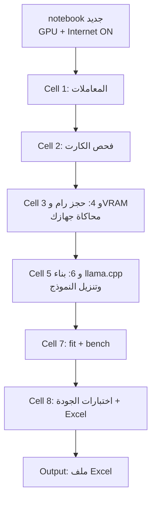
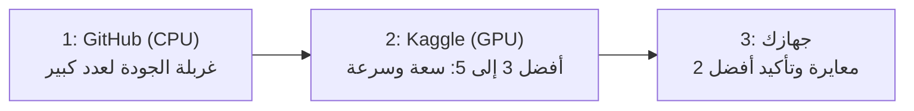

# توثيق مشروع: Workflow اختيار نماذج Hugging Face (GGUF) أونلاين
## HF Model Selection Workflow — GitHub Actions

| البند | القيمة |
|---|---|
| الإصدار (Version) | 1.1 |
| التاريخ (Date) | 2026-11-06 |
| الحالة (Status) | تصميم مقترح، لم يُنفَّذ بعد. السكربتات في الملاحق هياكل (skeletons) لازم تتختبر قبل الاعتماد عليها |
| الهدف (Goal) | اختيار أنسب نموذج GGUF بنسخة Q4 لجهازك، من غير تنزيل أي نموذج على جهازك قبل الاختبار |
| الجهاز المستهدف (Target) | Intel i7-6920HQ، رام 16 GB، Quadro M4000M بذاكرة 4 GB، Windows 10 Pro 22H2 (التفاصيل في القسم 5) |
| الجديد في 1.1 | مواصفات الجهاز الكاملة، قسم محاكاة الجهاز (12)، قسم Kaggle (13)، قسم Kaggle Benchmarks (14)، ملف `device_profile.yaml`، نموذج سرعة التوليد ومعالجة الـ prompt، وتعديل سرعة الرام الافتراضية إلى 27 GB/s (كانت 30) فتغيّرت أرقام جدول القسم 9.3 |

> الأرقام المعلّمة بـ (تقدير) أو (افتراض) مش مقاسة. الأرقام المأخوذة من مصادر خارجية مذكورة في القسم 16 مع تاريخ التحقق.

---

## فهرس المحتويات (Table of Contents)

1. ملخص سريع
2. المشكلة والهدف
3. الفكرة
4. ما الذي ينتقل من الـ runner لجهازك
5. جهازك المستهدف
6. حدود GitHub Actions
7. المعمارية وحقول الإدخال
8. مرحلة 1: التجهيز والتنزيل
9. مرحلة 2: فحص الذاكرة وتقدير السرعة
10. مرحلة 3: اختبارات الجودة
11. مرحلة 4: تقرير Excel وقاعدة الاختيار
12. محاكاة جهازك (Device Simulation)
13. Kaggle: الفكرة وطريقة التنفيذ
14. Kaggle Benchmarks
15. المخاطر، خطة التنفيذ، وقرارات معلّقة
16. المصادر وحالة التحقق
17. الملاحق

---

## 1. ملخص سريع (TL;DR)

- الفكرة شغالة: workflow يدوي (`workflow_dispatch`) بتدخله اسم النموذج في حقل، والسيرفر ينزّل ملف الـ GGUF، ويثبّت llama.cpp، ويشغّل اختبارات، ويرجّعلك ملف Excel.
- التنزيل بيحصل على سيرفر GitHub مش على جهازك.
- الاختبار هيتم على CPU فقط. مفيش كارت NVIDIA على الـ runner، ومفيش طريقة تحاكي M4000M وتدّي سرعة حقيقية.
- مش ضروري المحاكاة علشان تختار: الجودة بتتنقل بالكامل، والذاكرة بتتحسب بدقة، والسرعة بتتقدّر كسقف نظري ويمكن معايرتها.
- قاعدة الاختيار المقترحة: فلترة بالـ fit والسرعة، وبعدين ترتيب بالجودة (القسم 11).
- محاكاة جهازك على 3 طبقات: سعة (رام وVRAM)، ونموذج تحليلي بمواصفاتك، ومعايرة على جهازك. السرعة الدقيقة مش ممكنة من غير المعايرة (القسم 12).
- Kaggle بيدّيك GPU فعلي (P100 أو T4) لقياس الـ fit والسرعة، وGitHub بيدّيك غربلة الجودة بالمجان. الأفضل تستخدمهم مع بعض (القسم 13).
- Kaggle Benchmarks بيختبر **جودة** نماذج مستضافة بس. مفيش فيه سرعة أو تشغيل على جهازك، وليه استخدام مرجعي (القسم 14).

---

## 2. المشكلة والهدف (Problem & Goal)

**المشكلة:** عندك عدة نماذج على Hugging Face ومش عارف أنهي أنسب ليك، ومش عايز تنزّل أي واحد منهم قبل ما تتأكد إنه يستاهل.

**احتياجاتك المحددة (Requirements):**

| الاحتياج | الوصف |
|---|---|
| العامية المصرية (Egyptian Arabic) | قوة النموذج في الفهم والكتابة بالعامية |
| التفكير المنظم (Structured reasoning) | تفكير منطقي ومنظم وعميق |
| المستندات المنسقة (Formatted documents) | كتابة مستندات منسقة بعناوين وقوائم وجداول |
| أمثلتك الشخصية (Personal tasks) | حالات استخدام خاصة بيك تضيفها بنفسك |
| الملاءمة للجهاز (Device fit) | النموذج لازم يشتغل بشكل مقبول على 4 GB VRAM و16 GB RAM بنسخة Q4 |

**ما هو خارج النطاق (Out of scope):** قياس حمل الكارت الفعلي (GPU utilization)، ومحاكاة كارت NVIDIA، وتدريب أو ضبط النماذج.

---

## 3. الفكرة (The Idea)



**خطوات الاستخدام:**

1. تفتح تبويب Actions في الـ repo وتختار الـ workflow وتضغط Run workflow.
2. تملأ الحقول: اسم النموذج (أو عدة نماذج مفصولة بفاصلة) وإعدادات جهازك.
3. السيرفر يشتغل لوحده، وبعد انتهائه تنزّل ملف Excel من الـ artifacts.
4. تقرأ شيت Summary وتراجع يدويًا عينة من الإجابات وتقيّمها، وتختار النموذج.

---

## 4. ما الذي ينتقل من الـ runner لجهازك؟ (What transfers)

| القياس (Measure) | بيتنقل؟ | الطريقة (Method) | ملاحظات |
|---|---|---|---|
| الجودة (Quality) | نعم، بالكامل | نفس ملف GGUF ونفس الإعدادات على CPU | فروق رقمية صغيرة بين CPU وGPU ممكن تغيّر كلمة هنا وهناك |
| ذاكرة الكارت (VRAM fit) | نعم، بالحساب | معادلة من metadata الملف | دقتها كويسة لكن لازم تتأكد بتشغيل فعلي مرة |
| الرام (RAM) | نعم، بالقياس | أقصى استهلاك فعلي (peak RSS) للـ process | الـ runner 16 GB في الـ public repo |
| السرعة (Speed, tok/s) | لا، تقدير فقط | سقف نظري من سرعة الذاكرة | القسم 9، والمعايرة في القسم 12 |
| حمل الكارت والمعالج (Utilization) | لا | غير قابل للمحاكاة | خارج النطاق |

**ليه مفيش كارت وهمي؟** الـ runner العادي مفيهوش GPU أصلًا، والـ GPU runners متاحة بس لخطط Team وEnterprise. حتى مع وجود كارت تاني، سرعته مش هتمثل Maxwell القديم.

**لكن فيه محاكاة جزئية مفيدة:** السعة بتتحاكى بدقة، والسرعة بتتقدّر بنموذج بمواصفات جهازك وبتتصحح بمعايرة. التفاصيل في الأقسام 12 و13 و14.

---

## 5. جهازك المستهدف (Target hardware)

| المكوّن | المواصفة |
|---|---|
| المعالج (CPU) | Intel Core i7-6920HQ (Skylake، 14 nm): 4 نوى و8 threads، 2.9 GHz أساسي، turbo حتى 3.8 GHz (حتى 3.4 GHz على 4 نوى)، يدعم AVX2 وبدون AVX-512 |
| الرام (RAM) | 16.0 GB مثبتة (15.9 GB متاحة). المعالج بيدعم قناتين DDR4-2133 بحد أقصى نظري 34.1 GB/s. نوع الشرائح وعددها الفعلي غير معروف (تحقق منها في القسم 12.4) |
| كارت الشاشة (GPU) | NVIDIA Quadro M4000M: Maxwell GM204، 1280 نواة CUDA، 4 GB GDDR5 بناقل 256-bit، سرعة ذاكرة 160 GB/s، Compute Capability 5.2، أداء FP32 نظري 2.496 TFLOPS، PCIe 3.0 x16 |
| الكارت المدمج (iGPU) | Intel HD Graphics 530 (128 MB مخصصة) |
| التخزين | SSD سعة 932 GB (PNY CS2230 1TB) وSSD سعة 477 GB (Micron MTFDHBA512TDV) |
| النظام | Windows 10 Pro، الإصدار 22H2، build 19045.6466، 64-bit x64 |

### أثر المواصفات على الاختيار

| الخاصية | الأثر |
|---|---|
| VRAM = 4 GiB | الحد الأقصى لما يدخل الكارت. الميزانية العملية المقترحة 3.4 GiB (تقدير) |
| الرام = 15.9 GB | الحد الأقصى للجزء اللي بيشتغل على المعالج (مع حوالي 4 GiB للنظام، تقدير) |
| سرعة الرام 34.1 GB/s نظريًا | الجزء اللي على المعالج بياخد وقت أكبر بكتير من الجزء اللي على الكارت (القسم 9.4) |
| Maxwell CC 5.2 | بدون Tensor Cores، ويحتاج CUDA 12.x أو Vulkan (التحذير أدناه) |
| i7-6920HQ مع AVX2 | تشغيل النموذج على المعالج ممكن لكن أبطأ من معالجات AVX-512 |
| الكارت المدمج Intel HD 530 | الشاشة غالبًا بتشتغل عليه (Optimus)، وده بيوفر VRAM على كارت NVIDIA، لكن لازم تتأكد بـ `nvidia-smi` والجهاز فاضي |
| Windows 10 | تأكد إن نسخة llama.cpp الجاهزة لـ Windows مبنية بـ CUDA 12.x أو Vulkan، مش 13 |

### تحذير: CUDA 13 وكروت Maxwell

NVIDIA أعلنت إن CUDA 13 هتشيل الدعم للمعماريات القديمة (Maxwell وPascal وVolta)، ومصادر لاحقة بتأكد إن الخط الفاصل بقى Turing (compute capability 7.5). معنى ده لجهازك:

- لما تشغّل النموذج محليًا لازم تستخدم llama.cpp مبني بـ CUDA 12.x، أو نسخة Vulkan.
- لو ابتنيته بنفسك: `-DCMAKE_CUDA_ARCHITECTURES=52` مع toolkit من فرع 12.x.
- تأكد من أحدث وضع قبل التنزيل، لأن الدعم بيتغير من release لـ release.
- الـ workflow نفسه مش متأثر لأنه شغال على CPU.

---

## 6. حدود GitHub Actions (Limits)

| الحد (Limit) | القيمة | الأثر |
|---|---|---|
| تكلفة الـ runners العادية | مجانية وبدون حد دقائق في الـ public repos | الاختبار بيكلفك صفر |
| مواصفات runner (repo عام) | 4 vCPU / 16 GB RAM / 14 GB SSD | نموذج 7B بـ Q4 (حوالي 4 إلى 5 GB) بيشتغل براحة |
| مواصفات runner (repo خاص) | 2 vCPU / 8 GB RAM / 14 GB SSD | أبطأ وأضيق، وبيستهلك رصيد الدقائق |
| GPU | متاح بس في runners مدفوعة (Team أو Enterprise) | الاختبار على CPU |
| حقول الإدخال | حتى 25 حقل (كان 10) | كفاية للمشروع |
| مكان الملف | لازم يكون على الـ default branch علشان زرار Run workflow يظهر | |
| وقت الـ job | 6 ساعات (حسب معرفتي، لم أتحقق منه في هذه الجلسة) | لازم `timeout-minutes` وميزانية وقت |
| التخزين | 14 GB SSD | نزّل ملف الـ quant المطلوب بس، مش الـ repo كله |

**ملاحظة سرية البيانات:** لو الـ repo عام، أي حد يقدر يشوف ملفات الاختبار الشخصية. الحلول: repo خاص (مع مواصفات أقل ورصيد دقائق محدود)، أو تخزين الأمثلة الشخصية كـ Secret (الحد حوالي 48 KB حسب معرفتي) وقراءتها وقت التشغيل.

**ملاحظة أمان:** لا تحط قيمة `${{ inputs.* }}` مباشرة داخل أمر shell. مرّرها كـ environment variable علشان تتجنب الـ injection (مطبق في الملحق A).

---

## 7. المعمارية وحقول الإدخال (Architecture & Inputs)

### 7.1 هيكل الـ repo

```
hf-model-selector/
├── .github/workflows/evaluate.yml     # الـ workflow (الملحق A)
├── scripts/
│   ├── install_llamacpp.sh            # تثبيت llama.cpp
│   ├── download_model.py              # تنزيل ملف الـ GGUF
│   ├── fit_check.py                   # حساب الذاكرة والسرعة (الملحق B)
│   ├── run_tests.py                   # تشغيل الاختبارات وجمع القياسات
│   ├── scorers.py                     # دوال التصحيح الآلي
│   └── build_excel.py                 # بناء ملف Excel النهائي
├── notebooks/
│   └── kaggle_eval.py                 # notebook على Kaggle (الملحق F)
├── tools/
│   └── calibrate.ps1                  # معايرة جهازك على Windows (الملحق G)
├── tests/
│   ├── egyptian_arabic.yaml
│   ├── reasoning.yaml
│   ├── documents.yaml
│   └── personal.yaml                  # أمثلتك (الملحق C)
├── config/
│   ├── weights.yaml                   # أوزان الفئات
│   └── device_profile.yaml            # مواصفات جهازك ومعاملات المعايرة (الملحق E)
├── requirements.txt                   # gguf, huggingface_hub, requests, pyyaml, openpyxl, pandas, psutil
└── README.md
```

### 7.2 تسلسل الـ jobs



كل نموذج بيشتغل في job منفصل على runner خاص بيه (بالتوازي)، فمحدودية الـ 14 GB SSD والـ 6 ساعات بتنطبق على كل نموذج لوحده.

### 7.3 حقول الإدخال (7 من أصل 25 مسموح)

مواصفات جهازك اتنقلت من حقول الإدخال لملف واحد (`config/device_profile.yaml`، الملحق E) علشان تتكتب مرة واحدة وتتشارك بين GitHub وKaggle والمعايرة.

| الحقل (Input) | النوع | الافتراضي | الوصف |
|---|---|---|---|
| `models` | string | بدون | repo ids مفصولة بفاصلة، مثال: `XHToken/Spark-X2.5-1.7B-GGUF` |
| `quant_pattern` | string | `Q4_K_M` | نمط اسم ملف الـ quant |
| `ctx_size` | string | `4096` | حجم السياق للاختبار ولحساب الـ KV cache |
| `device_profile` | string | `config/device_profile.yaml` | ملف مواصفات جهازك (الميزانية، سرعات الذاكرة، معاملات المعايرة) |
| `threads` | string | `4` | threads على الـ runner (بيأثر على وقت الاختبار فقط، مش على الإجابات) |
| `kv_cache_type` | choice | `f16` | `f16` أو `q8_0` |
| `test_profile` | choice | `quick` | `quick` للغربلة أو `full` للتقييم الكامل |

> الوحدات: كل الأحجام بالـ GiB (1 GiB = 1,073,741,824 byte). كارت 4 GB هو فعليًا 4 GiB. سرعات الذاكرة بالـ GB/s العشرية.

### 7.4 المخرجات (Outputs)

- artifact لكل نموذج: ملف JSON بالنتائج وملف بالإجابات الخام.
- artifact نهائي: `model-comparison.xlsx`.
- ملخص مختصر في صفحة الـ job (`$GITHUB_STEP_SUMMARY`).

---

## 8. مرحلة 1: التجهيز والتنزيل (Setup & Download)

### 8.1 تنزيل النموذج

- استخدم `huggingface_hub` بـ `allow_patterns` لتنزيل ملف الـ quant المطلوب بس.
- لو الملف مقسّم (مثل `-00001-of-00003.gguf`) نزّل كل الأجزاء، وllama.cpp بيقرا من الجزء الأول.
- **حارس التخزين (Disk guard):** قبل التنزيل اقرا أحجام الملفات من الـ API، ولو المجموع أكبر من حد معين (مقترح: 10 GiB من 14) وقّف الـ job برسالة واضحة.
- لو مفيش ملف مطابق للنمط، اطبع قائمة الملفات المتاحة وفشّل الـ job علشان تصحح النمط.
- النماذج المقيّدة (gated) محتاجة Secret باسم `HF_TOKEN`.
- راجع ترخيص كل نموذج قبل ما تعتمد عليه فعليًا.

### 8.2 تثبيت llama.cpp

| الخيار | المزايا | العيوب |
|---|---|---|
| Release جاهز (CPU، Ubuntu x64) | سريع، بدون بناء | اسم الـ asset ممكن يتغير، لازم السكربت يختار بالـ regex |
| بناء من المصدر (`cmake`، بدون CUDA) | مضمون ومستقل عن أسماء الـ assets | بياخد وقت (تقدير: عدة دقائق)، ويفضل تعمل cache للـ build |

القرار المقترح: جرّب الـ release الجاهز أولًا، ولو فشل ابني من المصدر. **ثبّت tag محدد** (حقل اختياري أو ملف config) علشان النتائج تبقى قابلة للمقارنة بين الـ runs، وسجّل الـ tag في شيت Meta.

### 8.3 تشغيل السيرفر

```bash
llama-server -m "$MODEL" -c "$CTX" -t "$THREADS" \
  --host 127.0.0.1 --port 8080 --jinja \
  --cache-type-k "$KV" --cache-type-v "$KV"
```

- `--jinja` بيستخدم الـ chat template المدمج في الـ GGUF. لو الـ template ناقص أو غلط، النتائج هتبقى مضللة، فالسكربت لازم يسجّل وجود الـ template ويعلّم النموذج لو ناقص.
- تكميم الـ V cache (مع `q8_0`) محتاج flash attention في llama.cpp. صيغة الأعلام بتتغير بين النسخ، فراجع `llama-server --help` للنسخة اللي ثبّتها.
- انتظر `GET /health` لحد ما يرجّع 200 قبل ما تبدأ الاختبارات.
- الطلبات بتروح لـ `POST /v1/chat/completions`، والرد بيحتوي حقل `timings` فيه سرعة المعالجة والتوليد على الـ runner.

---

## 9. مرحلة 2: فحص الذاكرة وتقدير السرعة (Fit Check & Speed Ceiling)

### 9.1 المدخلات من الملف

السكربت بيقرا من metadata الـ GGUF (بالمفاتيح `{arch}.block_count` و`{arch}.attention.head_count` و`{arch}.attention.head_count_kv` و`{arch}.embedding_length` وأحيانًا `{arch}.attention.key_length`) ومن حجم الملف الفعلي.

### 9.2 المعادلات

```
head_dim        = key_length  (لو موجود)  أو  embedding_length / head_count
KV_layer (byte) = 2 × ctx × kv_heads × head_dim × bytes_per_element
KV_total        = n_layers × KV_layer
need_full       = file_size + KV_total + compute_buffer         # compute_buffer = 0.3 GiB (افتراض)
```

| نوع الـ KV | bytes لكل عنصر | ملاحظة |
|---|---|---|
| `f16` | 2 | الافتراضي |
| `q8_0` | 34 ÷ 32 = 1.0625 | بيصغّر الـ KV لحوالي 53% من حجمه |
| `q4_0` | 18 ÷ 32 = 0.5625 | تأثير أكبر على الجودة، اختبره قبل الاعتماد |

**قرار التوزيع:**

1. لو `need_full ≤ vram_budget_gib` فكل الـ layers على الكارت (`-ngl` = عدد الـ layers).
2. غير كده: `avail = (vram_budget − compute_buffer) × 0.95`، و`ngl = floor(avail ÷ (file_size ÷ n_layers + KV_layer))` بحد أدنى 0 وأقصى n_layers. معامل 0.95 هامش أمان.

**تصنيف الـ fit:**

| التصنيف (Fit class) | الشرط | المعنى |
|---|---|---|
| Full GPU | `ngl` = n_layers | النموذج كله على الكارت |
| Partial | `ngl` ≥ 50% من الـ layers | مقبول، السرعة بتتأثر بالرام |
| Mostly CPU | `ngl` < 50% | غالبًا بطيء، مش مناسب لو السرعة مهمة |
| No fit | الجزء اللي على الرام + overhead (تقدير 4 GiB للنظام) أكبر من `ram_gib` | مش هيشتغل |

### 9.3 مثال محسوب

الأرقام دي طلعت من تشغيل فعلي لدالة الحساب في الملحق B. مواصفات النموذج (32 layer، 8 KV heads، head_dim = 128) مثال توضيحي مش نموذج بعينه، وسرعة الرام الفعلية 27 GB/s افتراض (حوالي 80% من النظري 34.1 GB/s):

| الحالة | الملف | KV total | الاحتياج الكامل | `ngl` | سقف السرعة |
|---|---|---|---|---|---|
| نموذج 8B بـ Q4، ctx 4096، `f16` | 4.9 GB = 4.563 GiB | 0.500 GiB (16 MiB لكل layer) | 5.363 GiB (أكبر من 3.4) | 18 من 32 (56.2%) | 10.3 tok/s |
| نفس النموذج بـ KV `q8_0` | 4.563 GiB | 0.266 GiB (8.5 MiB لكل layer) | 5.129 GiB | 19 من 32 (59.4%) | 10.9 tok/s |
| نفس النموذج على CPU فقط | بدون كارت | بدون | بدون | 0 | 5.5 tok/s |
| نموذج 1.7B بـ Q4 (ملفه 1.1 GB، 28 layer افتراضًا) | 1.024 GiB | 0.438 GiB | 1.762 GiB | 28 من 28 (كامل) | 145.5 tok/s |

شكل ذاكرة الكارت لنموذج متوسط داخل بالكامل (مثال: ملف 2.5 GiB، KV 0.5، حاجز الشاشة والـ compute 0.7):

```
VRAM = 4.0 GiB    كل حرف = 0.1 GiB
[█████████████████████████▓▓▓▓▓▒▒▒▒▒▒▒░░░]
 الأوزان 2.5 | KV 0.5 | حاجز 0.7 | فاضي 0.3
```

### 9.4 سقف السرعة (Speed ceiling)

توليد الـ tokens محكوم أساسًا بسرعة قراءة الأوزان من الذاكرة:

```
زمن الـ token (ثانية) = gpu_gb ÷ gpu_bandwidth + cpu_gb ÷ ram_bandwidth
السقف (tok/s)         = 1 ÷ زمن الـ token          # الـ GB هنا عشرية
```

| حجم الملف | السقف على الكارت لو كله عليه (160 GB/s) |
|---|---|
| 1.1 GB | حوالي 145 tok/s |
| 2.5 GB | حوالي 64 tok/s |
| 3.0 GB | حوالي 53 tok/s |

**ده سقف مش توقع.** كارتك قديم (Maxwell، بدون Tensor Cores)، فالواقع غالبًا أقل بكتير. ولما جزء من الـ layers على المعالج، سرعة الرام هي اللي بتتحكم.

### 9.4 (تكملة) سقف سرعة معالجة الـ prompt (Prompt processing ceiling)

معالجة الـ prompt (والـ tokens الأولى) محكومة بقدرة الحساب مش بسرعة الذاكرة:

```
pp_tps = 1 ÷ ( share_gpu × 2P ÷ FLOPS_gpu  +  share_cpu × 2P ÷ FLOPS_cpu )
P = عدد البارامترات، FLOPS_gpu = 2.496 TFLOPS، FLOPS_cpu = 4 × 3.4 GHz × 32 = 435.2 GFLOPS (AVX2، نظري)
```

| الحالة | سقف التوليد (tg) | سقف معالجة الـ prompt (pp) |
|---|---|---|
| نموذج 1.7B كله على الكارت | 145.5 tok/s | 734 tok/s |
| نموذج 8B بـ Q4، 18 من 32 layer على الكارت | 10.3 tok/s | 50.6 tok/s |
| نفس النموذج على المعالج فقط | 5.5 tok/s | 27.1 tok/s |

لو كله على الكارت، سقف pp لنموذج 4B حوالي 312 tok/s ولنموذج 8B حوالي 156 tok/s. كلها أرقام نظرية، والواقع على Maxwell غالبًا أقل بكتير.

### 9.5 حدود التقدير (Limitations)

- نماذج MoE: الملف بيشمل كل الخبراء لكن كل token بيقرا الخبراء النشطة بس، فالسقف المحسوب أقل من الحقيقي. علّم النموذج كـ MoE في التقرير.
- بعض النماذج بتستخدم `head_count_kv` مختلف لكل layer أو sliding window أو طبقات هجينة. الكود بيجمع لو القيمة قائمة، لكن راجع الأرقام.
- قسمة حجم الملف على عدد الـ layers تقريب (الـ embedding والـ output layer مش بنفس حجم باقي الطبقات). هامش الأمان 0.95 بيغطي جزء من الخطأ.
- llama.cpp الحديث فيه ضبط تلقائي لتوزيع الـ layers (`--fit`، والهامش بـ `--fit-target`). حسابنا هنا فحص مبدئي، وعلى جهازك الأداة هي اللي هتقرر الفعلي.
- **تحقق مرة بتشغيل فعلي:** بعد ما تختار نموذج، شغّله محليًا بالـ `-ngl` المقترح وراقب الـ VRAM بـ `nvidia-smi`.

---

## 10. مرحلة 3: اختبارات الجودة (Quality Tests)

### 10.1 المبادئ

- نفس الإعدادات لكل النماذج: `temperature = 0` و`seed = 42` وبدون system prompt، ونفس الـ `ctx_size`.
- نفس الـ quant اللي ناوي تستخدمه فعلًا.
- `max_tokens` ثابت لكل فئة: عامية 150، تفكير 400، مستندات 700، شخصي 500.
- التصحيح الآلي بيقيس اللي ينقاس بثقة (تنسيق، إجابات محددة، كلمات). الجودة اللغوية في العامية بتتقيّم يدويًا.

### 10.2 الفئات والتصحيح

| الفئة (Category) | عدد الأسئلة (quick / full) | نوع الأسئلة | طريقة التصحيح الآلي |
|---|---|---|---|
| العامية المصرية (Egyptian Arabic) | 10 / 20 | نوعين: أسئلة فهم بإجابة قصيرة، وطلبات كتابة بالعامية | الفهم: `must_include`. الكتابة: معادلة الدرجة أدناه |
| التفكير المنظم (Reasoning) | 10 / 20 | ألغاز منطق ومسائل إجابتها النهائية قيمة واحدة | exact match على سطر `الإجابة النهائية:` بعد توحيد الأرقام والمسافات |
| المستندات المنسقة (Documents) | 5 / 10 | اطلب تقرير أو خطة أو مذكرة بهيكل محدد | validators: عدد العناوين، قوائم، جدول، أقسام مطلوبة، نطاق الطول |
| أمثلتك الشخصية (Personal) | كلها | من ملف `personal.yaml` | `must_include` و`must_not_include` و`regex` لكل سؤال |

**معادلة درجة الكتابة بالعامية (مقترح مبدئي، عدّل الأوزان بالتجربة):**

```
auto = 100 × ( 0.4 × ar_ok
             + 0.3 × (1 − min(1, msa_hits / 3))
             + 0.3 × min(1, colloq_hits / 2) )

ar_ok        = 1 لو نسبة الحروف العربية ≥ 0.8، وغير كده = النسبة ÷ 0.8
msa_hits     = عدد كلمات الفصحى الثقيلة الموجودة (قائمة في الملحق C)
colloq_hits  = عدد علامات العامية الموجودة (قائمة في الملحق C)
```

لو قيّمت يدويًا (1 إلى 5): `manual = (rating − 1) ÷ 4 × 100` والدرجة النهائية للفئة = `0.5 × auto + 0.5 × manual`.

### 10.3 مؤشرات الصحة (Health flags)

بتتسجل في شيت Details ولا تدخل في الدرجة، لكن بتدخل في بوابة الاختيار:

| المؤشر | الشرط |
|---|---|
| مبتور (Truncated) | `finish_reason == "length"` |
| تكرار (Repetition) | نفس مقطع من 5 كلمات اتكرر 4 مرات أو أكتر |
| انحراف لغة (Language drift) | سؤال عربي وإجابة أغلبها لاتيني بدون طلب |
| رموز خام (Raw tokens) | ظهور رموز زي `<|im_start|>` أو `<|eot_id|>` في الإجابة (علامة مشكلة template) |
| إجابة فاضية (Empty) | طول الإجابة صفر |

### 10.4 الدقة الإحصائية (Statistical caveat)

هامش الخطأ التقريبي لنسبة نجاح 50% بثقة 95%:

| عدد الأسئلة (n) | هامش الخطأ |
|---|---|
| 20 | ±21.9 نقطة |
| 50 | ±13.9 نقطة |
| 200 | ±6.9 نقطة |

يعني الاختبار بـ 10 إلى 20 سؤال لكل فئة **أداة غربلة** بتفرّق بين نموذج ضعيف جدًا وقوي، مش بين نموذجين متقاربين. للمتقاربين استخدم الجولة الثانية (القسم 11.3) والتقييم اليدوي.

### 10.5 ميزانية الوقت (Time budget)

الوقت الأقصى = إجمالي الـ tokens الأقصى ÷ السرعة (بدون حساب وقت معالجة الـ prompt):

| الـ profile | إجمالي `max_tokens` | عند 4 tok/s | عند 15 tok/s |
|---|---|---|---|
| quick (مع 10 أسئلة شخصية) | 14,000 | 58.3 دقيقة | 15.6 دقيقة |
| full (مع 10 أسئلة شخصية) | 23,000 | 95.8 دقيقة | 25.6 دقيقة |

السرعتين (4 و15 tok/s) افتراضات لتوضيح الحساب مش قياسات. الحد الأقصى فعليًا أقل لأن أغلب الإجابات بتخلص قبل `max_tokens`. اضبط `timeout-minutes` وضيف حقل أو ثابت `max_total_minutes` يوقف الاختبار بشكل نظيف قبل الـ 6 ساعات.

---

## 11. مرحلة 4: تقرير Excel وقاعدة الاختيار (Report & Selection Rule)

### 11.1 شيتات الملف

| الشيت (Sheet) | المحتوى |
|---|---|
| Summary | صف لكل نموذج: الملف، الـ fit، `ngl`، سقف السرعة، درجة كل فئة، الدرجة الكلية، عدد المؤشرات، متوسط التقييم اليدوي، القرار |
| Fit | تفاصيل الحساب: الـ layers، الـ KV، الاحتياج الكامل، التصنيف، فحص الرام، أمر التشغيل المقترح |
| Details | صف لكل سؤال: النموذج، الفئة، الـ prompt، الإجابة، نتيجة كل فحص، الـ tokens، الزمن، المؤشرات، عمود `rating` (1 إلى 5) للتقييم اليدوي |
| Meta | إعدادات التشغيل، نسخة llama.cpp، الأوزان، `min_tps`، تاريخ التشغيل |

**تفاصيل عملية:**

- الدرجة الكلية في Summary تكون **معادلة Excel** بتقرا الأوزان من Meta، فلما تغيّر الوزن يتغير الترتيب فورًا.
- متوسط التقييم اليدوي بـ `AVERAGEIFS` على عمود `rating` في Details، وبيدخل في درجة الفئة تلقائيًا.
- تنسيق شرطي (color scale) على أعمدة الدرجات، وData validation على عمود `rating` (أرقام من 1 إلى 5).
- أمر التشغيل المقترح في شيت Fit مثال: `llama-server -m <file> -ngl 18 -c 4096` (الرقم من الحساب).

### 11.2 قاعدة الاختيار (Selection rule)



1. **البوابة:** استبعد أي نموذج fit بتاعه Mostly CPU أو No fit، أو سقف سرعته (بعد المعايرة لو متاحة) أقل من `min_tps`، أو فيه مؤشرات صحة في أكتر من 10% من الأسئلة. القيمة المبدئية لـ `min_tps` هي 8 كتخمين، وانت اللي تحددها حسب استعمالك.
2. **الترتيب:** رتّب الناجحين بالدرجة الكلية.
3. **التعادل:** لو الفرق أقل من 5 نقاط (أقل من هامش الخطأ)، فضّل الأسرع ثم الأصغر ملفًا.
4. **الجولة الثانية (11.3):** أفضل 2 إلى 3 نماذج بس.

### 11.3 الجولة الثانية للمتأهلين (Finalists round)

- شغّل `test_profile = full`.
- زوّد أسئلتك الشخصية (50 سؤال يدّي هامش ±13.9).
- اقرا 15 إجابة على الأقل لكل نموذج بنفسك وقيّمها.
- نزّل النموذج على جهازك مرة وجرّب `-ngl` المقترح، وشوف الـ VRAM والسرعة الفعلية.

---

## 12. محاكاة جهازك (Device Simulation)

### 12.1 الممكن وغير الممكن

مفيش طريقة تخلّي كارت تاني (T4 أو P100) أو معالج تاني يتصرف زي Quadro M4000M وi7-6920HQ من ناحية السرعة. اللي ممكن هو ثلاث طبقات بتتجمع مع بعض:

| الطبقة (Layer) | بتحاكي إيه | النتيجة | الدقة المتوقعة | بتتنفذ فين |
|---|---|---|---|---|
| A: محاكاة السعة (Capacity emulation) | حد الرام (15.9 GiB) وحد VRAM (حوالي 3.4 GiB) وعدد الأنوية | يدخل ولا لأ، عدد الـ layers، أقصى رام وVRAM | عالية (تحتاج تحقق) | Kaggle (حجز ذاكرة) وGitHub (حاوية بحدود) |
| B: النموذج التحليلي (Spec-driven model) | مواصفات جهازك كأرقام: سرعات الذاكرة وقدرة الحساب | سقف سرعة التوليد (tg) ومعالجة الـ prompt (pp) | سقف نظري، أعلى من الواقع | أي مكان (حساب بس) |
| C: المعايرة (Calibration) | قياس حقيقي على جهازك | معاملات تصحيح (η) تقرّب B من الواقع | متوسطة إلى عالية بعد التحقق | جهازك، مرة واحدة |

**ليه مش بنقدر نبطّئ كارت تاني ونخليه زي M4000M؟**

| السبب | التفاصيل |
|---|---|
| اختلاف المعمارية | Maxwell غير Pascal وTuring. الـ kernels والمسارات اللي بيستخدمها llama.cpp مختلفة، فمجرد تقليل السرعة مش بيعيد نفس السلوك |
| ضبط الـ clocks | تثبيت أو تقليل ترددات الكارت محتاج صلاحيات على الـ driver، وحسب معرفتي مش متاح داخل Kaggle أو GitHub (لم أتحقق) |
| اختلاف المعالج | معالجات السيرفرات فيها كاش وتعليمات وأنوية مختلفة عن i7-6920HQ، فسرعة الجزء اللي على المعالج مش هتتطابق |
| الحرارة والطاقة | لابتوب بيخفّض السرعة مع الحرارة (throttling)، وده مش بيتحاكى |



### 12.2 الطبقة A: محاكاة السعة (Capacity emulation)

| المورد | جهازك | GitHub runner | Kaggle |
|---|---|---|---|
| الرام | 15.9 GiB متاحة | الـ runner 16 GB أصلًا، والنظام بياخد جزء. لتحديد أدق شغّل الاختبار في حاوية Docker بحد `--memory` | الـ session فيها حوالي 29 GB. احجز ballast بحجم الفرق (Cell 3 في الملحق F) |
| المعالج | 4 نوى / 8 threads | 4 vCPU: استخدم `-t 4` | 4 CPU cores: استخدم `-t 4` |
| VRAM | 4 GiB (ميزانية 3.4) | مفيش كارت | احجز ballast على الكارت لحد ما الفاضي يبقى حوالي 3.4 GiB (Cell 4) |
| السياق والـ KV | نفس القيم | نفس القيم | نفس القيم |

**ملاحظات:**

- llama.cpp الحديث بيظبط توزيع الـ layers تلقائيًا على حسب الذاكرة الفاضية على الكارت (`--fit` شغّال افتراضيًا). مع الـ ballast، الأداة هتختار نفس الـ layers اللي هتختارها على كارت 4 GB. و`--fit-target` بيحدد الهامش اللي يفضل فاضي (الافتراضي 1024 MiB).
- على جهازك الفعلي، هامش 1024 MiB كبير على كارت 4 GB. جرّب `--fit-target` أصغر لما تشغّل النموذج.
- الـ ballast بيحاكي **السعة** مش **السرعة**، والرام والـ VRAM بيتحكموا في الـ fit بس.
- كروت Turing وPascal ممكن تحجز compute buffer بحجم مختلف عن Maxwell، فنتيجة الـ fit تقريبية. تحقق منها مرة على جهازك.
- لازم تتأكد بـ `nvidia-smi` إن الفاضي بعد الحجز يقارب الميزانية، وتعدّل الرقم لو فيه فرق صغير (سياق CUDA بيحجز جزء).
- كل ده غير مختبر على Kaggle، وده سبب وجود خطوة التحقق على جهازك.

### 12.3 الطبقة B: النموذج التحليلي (Spec-driven model)

| المعامل | القيمة | المصدر |
|---|---|---|
| سرعة ذاكرة الكارت | 160 GB/s | مواصفات M4000M |
| قدرة حساب الكارت (FP32) | 2.496 TFLOPS | مواصفات M4000M |
| سرعة الرام الفعلية | 27 GB/s | افتراض: حوالي 80% من النظري 34.1 GB/s |
| قدرة حساب المعالج | 435.2 GFLOPS | حساب نظري: 4 نوى × 3.4 GHz × 32 (AVX2: وحدتي FMA × 8 أعداد × 2) |
| PCIe بين المعالج والكارت | حوالي 15.75 GB/s | نظري لـ PCIe 3.0 x16. تأثيره صغير لأن اللي بينتقل activations بس |

```
t_tg = gpu_gb ÷ (BW_gpu × η_gpu_tg) + cpu_gb ÷ (BW_ram × η_cpu_tg)
t_pp = share_gpu × 2P ÷ (FLOPS_gpu × η_gpu_pp) + share_cpu × 2P ÷ (FLOPS_cpu × η_cpu_pp)
tg_tps = 1 ÷ t_tg      pp_tps = 1 ÷ t_pp      وقت أول token ≈ عدد tokens الـ prompt ÷ pp_tps
```

قبل المعايرة كل معاملات η = 1.0، يعني الأرقام سقف نظري (جدول القسم 9.4). الكود في الملحق B (`speed_model`) واتجرّب. والـ report لازم يكتب بوضوح إن الرقم "غير معاير" لحد ما تتملي معاملات η في الملف.

### 12.4 الطبقة C: المعايرة على جهازك (Calibration)

الخطوات (بتتعمل مرة واحدة وبتاخد دقايق قليلة، مع تنزيل 2 أو 3 نماذج صغيرة بنسخة Q4):

1. **الرام:** شغّل `Get-CimInstance Win32_PhysicalMemory` وشوف عدد الشرائح وسرعتها. شريحتين DDR4-2133 = 34.1 GB/s نظريًا، وشريحة واحدة بتقلل السرعة لحوالي النص. عدّل `channels` و`bw_effective_gbps` في الملف.
2. **VRAM والجهاز فاضي:** `nvidia-smi --query-gpu=memory.used,memory.total --format=csv`. لو الاستهلاك صغير (الشاشة على الكارت المدمج)، ممكن ترفع الميزانية فوق 3.4.
3. **llama.cpp على جهازك:** نسخة CUDA 12.x أو Vulkan (القسم 5).
4. **القياس:** شغّل `calibrate.ps1` (الملحق G) على ثلاث حالات: (أ) نموذج صغير كله على الكارت (`-ngl 99`)، (ب) نموذج أكبر بتوزيع جزئي (`-ngl` من شيت Fit)، (ج) معالج فقط (`-ngl 0`). جرّب `-t 4` و`-t 8` وخد الأفضل.
5. **احسب معاملات η:**
   - `η_gpu_tg` = سرعة `tg128` المقاسة في الحالة (أ) ÷ السقف النظري لنفس النموذج.
   - `η_cpu_tg` = سرعة `tg128` المقاسة في الحالة (ج) ÷ (27 ÷ حجم الملف بالـ GB).
   - `η_gpu_pp` و`η_cpu_pp` بنفس الطريقة من قياسات `pp512`.
6. اكتب المعاملات تحت `calibration:` في `device_profile.yaml`.
7. **التحقق (Validation):** قِس نموذج رابع ما دخلش في المعايرة وقارنه بالمتوقع. معيار القبول المقترح: فرق أقل من 20% (رقم مقترح مني مش معيار علمي). لو الفرق أكبر، زوّد نقاط المعايرة.
8. **اختبار التحمل (Sustained):** شغّل القياس 10 دقايق وراقب الحرارة والسرعة بـ `nvidia-smi --query-gpu=temperature.gpu,clocks.sm,power.draw --format=csv -l 5`. اللابتوب ممكن ينزل السرعة بعد دقايق، والتقدير مش هيشوف ده.

### 12.5 أقرب GPU على Kaggle (Proxy GPU)

| الكارت | المعمارية | Compute Capability | VRAM | سرعة الذاكرة | ملاحظات |
|---|---|---|---|---|---|
| Quadro M4000M (هدفك) | Maxwell | 5.2 | 4 GB | 160 GB/s | بدون Tensor Cores |
| Tesla P100 (على Kaggle) | Pascal | 6.0 | 16 GB | حوالي 732 GB/s (معرفتي، لم يُتحقق) | بدون Tensor Cores، أقرب جيل لـ Maxwell |
| Tesla T4 (على Kaggle، اتنين) | Turing | 7.5 | 16 GB لكل كارت | حوالي 320 GB/s (معرفتي، لم يُتحقق) | فيه Tensor Cores، والكارتين مش بيجمعوا ذاكرتهم |

- حسب معرفتي (لم أتحقق منها): llama.cpp بيستخدم مسار dp4a للضرب المكمّم من compute capability 6.1، فالـ P100 (6.0) وMaxwell (5.2) بيستخدموا مسار مشترك أبطأ، والـ T4 بيستخدم مسار تاني. لو ده صح، الـ P100 أقرب في سلوك الـ kernels.
- تقدير خشن لسرعة التوليد: `tg على M4000M ≈ tg المقاسة على الكارت البديل × (160 ÷ سرعة ذاكرة البديل)`، يعني حوالي 0.22 للـ P100 وحوالي 0.5 للـ T4. ده مجرد مؤشر ومش بديل عن المعايرة.
- على Kaggle بتختار الكارت من إعدادات الـ Accelerator: P100 أو T4 x2. واستخدم كارت واحد بس (`CUDA_VISIBLE_DEVICES=0`).

### 12.6 الدقة المتوقعة (Expected accuracy)

| القياس | المصدر | الدقة المتوقعة | التحقق |
|---|---|---|---|
| الـ fit وعدد الـ layers (`ngl`) | حساب + `--fit` على VRAM محجوز | عالية، وممكن يختلف layer أو اتنين | تشغيل واحد على جهازك |
| أقصى رام (peak RSS) | قياس على الـ runner أو Kaggle | جيدة (الأوزان بتتحمل بـ mmap) | قياس على جهازك |
| VRAM المستهلك | `nvidia-smi` على Kaggle | تقريبية (اختلاف المعمارية) | `nvidia-smi` على جهازك |
| سرعة التوليد (tg) | النموذج التحليلي × η | متوسطة بعد المعايرة والتحقق | نموذج رابع (12.4 خطوة 7) |
| سرعة الـ prompt وأول token (pp) | النموذج التحليلي × η | أقل دقة | نفس الاختبار |
| الحرارة والطاقة والـ throttling | لا تُحاكى | غير متاحة | قياس محلي طويل (12.4 خطوة 8) |
| سرعة تحميل النموذج من الـ SSD | لا تُحاكى | غير متاحة | قياس محلي لو يهمك |

الأرقام النهائية للسرعة **ما تتعتبرش دقيقة** قبل المعايرة والتحقق. قبلهم هي سقف نظري بس.

---

## 13. Kaggle: الفكرة وطريقة التنفيذ

### 13.1 الفكرة على GitHub مقابل Kaggle

| الجانب | GitHub Actions | Kaggle Notebook |
|---|---|---|
| طريقة التشغيل | زرار Run workflow وحقول إدخال | تعدّل Cell المعاملات وتشغّل (Save Version ثم Save & Run All)، أو دفع تلقائي بالـ CLI |
| العتاد | CPU فقط: 4 vCPU و16 GB RAM (repo عام) | GPU: P100 أو 2×T4 (16 GB لكل كارت)، مع 4 CPU cores وحوالي 29 GB RAM |
| الحصة | مجاني وبدون حد دقائق (repo عام) | حوالي 30 ساعة GPU أسبوعيًا، وبتتغير حسب الطلب |
| أقصى وقت | 6 ساعات للـ job (معرفتي) | 12 ساعة للجلسة |
| الإنترنت | متاح دايمًا | لازم تفعّله من إعدادات الـ notebook علشان تنزّل llama.cpp والنموذج |
| التخزين | 14 GB SSD | حوالي 20 GB في `/kaggle/working` |
| المخرجات | artifact (ملف Excel) | ملفات في `/kaggle/working` بتنزّلها من تبويب Output |
| الخصوصية | repo عام بيظهر للكل | notebook خاص (private) بسهولة |
| حقول الإدخال | واجهة حقول جاهزة | مفيش واجهة معاملات جاهزة حسب علمي، فبتعدّل Cell أو بتحقن القيم بسكربت |
| الأنسب لـ | غربلة الجودة على نماذج كتير بالتوازي بدون استهلاك حصة | قياس الـ fit والسرعة على GPU فعلي وتجربة نماذج أكبر |

### 13.2 شكل الفكرة على Kaggle خطوة بخطوة



1. أنشئ notebook جديد، وفي Settings اختار Accelerator = GPU (P100 أو T4 x2) وفعّل Internet.
2. **Cell 1:** المعاملات (أسماء النماذج، الـ quant، `ctx_size`، ميزانية VRAM المحاكاة 3.4، حد الرام 15.9، الـ threads).
3. **Cell 2:** يفحص الكارت ويضبط `CUDA_VISIBLE_DEVICES=0`، ويفشل لو الكارت مش P100 أو T4.
4. **Cell 3:** يحجز رام بحجم الفرق علشان المتاح يبقى 15.9 GiB.
5. **Cell 4:** يحجز VRAM على الكارت علشان الفاضي يبقى حوالي 3.4 GiB.
6. **Cell 5 و6:** يبني llama.cpp بـ CUDA (arch 60 للـ P100 أو 75 للـ T4)، وينزّل ملف الـ GGUF.
7. **Cell 7:** يشغّل `llama-fit-params` لتوزيع الـ layers، وبعدها `llama-bench`.
8. **Cell 8:** يشغّل اختبارات الجودة ويكتب Excel في `/kaggle/working`.
9. شغّل بـ Save Version ثم Save & Run All، ونزّل النتائج من تبويب Output.

الكود كامل في الملحق F (هيكل لم يُختبر على Kaggle).

### 13.3 التشغيل التلقائي من GitHub (Hybrid)

الفكرة إن GitHub Action يبقى لوحة التحكم بحقول الإدخال، وKaggle هو اللي بينفذ على الـ GPU:

1. الـ Action يولّد ملف notebook ويحقن قيم المعاملات فيه.
2. يعمل `kaggle kernels push` مع `kernel-metadata.json` فيه `enable_gpu: true` و`enable_internet: true` و`is_private: true`.
3. يستنى لحد ما الحالة تخلص (`kaggle kernels status`) وبعدها ينزّل الملفات (`kaggle kernels output`).
4. يرفع الـ Excel كـ artifact.

**التوكن:** `KAGGLE_USERNAME` و`KAGGLE_KEY` كـ Secrets في GitHub. وفيه Action جاهز من المجتمع (`joel-hanson/kaggle-kernel-actions`) بيعمل خطوة الـ push.

**تحذيرات من تقارير مستخدمين (لم أتحقق منها):**

- اختيار نوع الكارت بالـ CLI (`--accelerator`) ممكن يرجع للافتراضي لو الاسم غلط، فخلّي Cell 2 يفشل لو الكارت مش المتوقع.
- Kaggle Secrets بتتشال لما تعمل push بالـ CLI. لو محتاج `HF_TOKEN` مرره بـ private dataset أو استخدم نماذج عامة.
- لازم تتأكد من اسم الـ accelerator الصحيح بـ `kaggle kernels push --help` للنسخة اللي معاك.

### 13.4 المسار المقترح: ثلاث مراحل



| المرحلة | المنصة | الغرض | المخرج |
|---|---|---|---|
| 1 | GitHub (CPU) | تقييم الجودة لعدد كبير من النماذج بالتوازي، بدون استهلاك حصة GPU | درجات الجودة وفحص fit تحليلي |
| 2 | Kaggle (GPU مع ballast) | قياس السعة (الـ layers، رام، VRAM) وسرعة على كارت بديل لأفضل 3 إلى 5 | `ngl` الفعلي وسرعة تقريبية |
| 3 | جهازك | معايرة وتأكيد أفضل 2 | معاملات η وسرعة حقيقية وقرار نهائي |

### 13.5 حدود Kaggle

- حصة الـ GPU الأسبوعية مش رقم ثابت في الوثائق (المصادر بتقول حوالي 30 ساعة)، واتبعت الرقم الظاهر في حسابك.
- الجلسة 12 ساعة، وحوالي 20 GB للملفات الناتجة.
- بناء llama.cpp بـ CUDA بياخد وقت في كل session جديدة. حدد arch واحد (60 أو 75) علشان تقلله، أو احفظ الـ binaries كـ dataset.
- بتاخد كارت واحد بس من الـ T4 x2، والذاكرة مش بتتجمع.
- مفيش صلاحيات root، فمفيش ضبط لترددات الكارت.

---

## 14. Kaggle Benchmarks

### 14.1 ما هو

Kaggle Benchmarks منصة لتقييم نماذج الذكاء الاصطناعي، وليها نوعين: **Research Benchmarks** (تقييمات من باحثين في معامل الـ AI، وبتحتاج حوسبة أكبر) و**Community Benchmarks** (تقييمات من المجتمع، وإنت اللي بتبنيها). النوعين تقنيًا متطابقين.

- بتكتب تقييم (task) بمكتبة مفتوحة اسمها `kaggle-benchmarks` باستخدام `@kbench.task`، وبتجمع المهام في benchmark.
- النموذج بيتنادى عبر واجهة موحدة (`llm`) من خلال بروكسي Kaggle، ومجانًا ضمن حصة. النماذج المتاحة: Gemini وClaude وQwen وDeepSeek وغيرها. نماذج OpenAI مش مدعومة في Community Benchmarks وقت الإطلاق.
- تقدر تشغّل المهمة على جدول (DataFrame) بـ `.evaluate()` وتاخد متوسط الأداء تلقائيًا.
- النتايج بتظهر في leaderboard، وفيه حوالي ألف benchmark مجتمعي منشورة (حسب إحصاء من يونيو 2026).
- الحصة بالدولار مش بالساعات: ظاهر في الواجهة "Daily AI Quota" و"Monthly AI Quota". القيم اللي شفتها في Issue عام هي 10$ يوميًا و100$ شهريًا لحساب عادي، و50$ و500$ في هاكاثون (غير رسمي وقد يتغير).

### 14.2 هل ينفع أختبر نموذج من Kaggle Benchmarks؟

| سؤالك | الإجابة |
|---|---|
| أقدر أختبر **جودة** نموذج متاح في Benchmarks على أسئلتي (عامية، تفكير، مستندات، شخصي)؟ | نعم: بتكتب Task بالـ SDK وتشغّله من notebook على Kaggle. |
| أعرف سرعته أو حمله على جهازي؟ | لا. بيشتغل على خوادم، وسرعة الـ API ملهاش علاقة بجهازك. |
| أنزّله وأشغّله على جهازي؟ | لا من Benchmarks نفسه. لو النموذج مفتوح الأوزان وله نسخة GGUF صغيرة على Hugging Face، اختبرها في المسار بتاعنا (الأقسام 12 و13) بنفس الأسئلة. |
| أضيف نموذجي المضبوط (fine-tuned GGUF)؟ | غالبًا لا. النماذج المدعومة قائمة مستضافة، ولم أجد في الوثائق دعمًا لنماذج مخصصة. |
| النماذج دي هتدخل في 4 GB؟ | غالبًا لا. أغلبها نماذج كبيرة (Frontier). |

### 14.3 فين يفيدك

1. **مرجع للجودة (Reference):** شغّل نفس أسئلتك على نموذج كبير. لو فشل في سؤال، ممكن السؤال نفسه ضعيف (إجابة متوقعة غلط أو غامضة)، فتصلحه قبل ما تظلم النماذج الصغيرة.
2. **قاضي (LLM-as-judge) لجودة العامية:** تقييم إجابات النماذج المحلية بنموذج كبير. ده بيستهلك من حصة الـ AI، وفيه تحيز، فاعتبره مساعد للتقييم اليدوي مش بديل عنه. قيّم 20 إجابة بنفسك على الأقل للتأكد.
3. **استكشاف المرشحين:** دوّر في الـ leaderboards عن benchmarks عربية أو للهجات لتعرف أي عائلات نماذج قوية، وبعدها دوّر على نسخ صغيرة منها بصيغة GGUF. **انتبه:** درجة النموذج الكبير مش بتنتقل للنسخة الصغيرة المكمّمة.

### 14.4 ربطه بمشروعك: "اكتب مرة وشغّل مرتين"

أسئلتك ومصححاتها تتكتب مرة واحدة (ملفات YAML و`scorers.py`)، ويبقى فيه adapter للنماذج المحلية (llama-server) وadapter تاني للنماذج المستضافة (kbench).

| المكوّن | مشترك؟ |
|---|---|
| ملفات الأسئلة (YAML) والمصححات (`scorers.py`) | نعم |
| استدعاء النموذج | لا: `llama-server` للمحلي، و`llm` من kbench للمستضاف |
| الـ fit والسرعة والرام | للنماذج المحلية بس |
| التقرير | نفس الـ Excel، مع عمود يوضح مصدر النموذج (محلي أو مستضاف) |

هيكل Task (شبه كود): الصيغة الدقيقة لاستدعاء النموذج والتأكيدات لازم تتاخد من توثيق الـ SDK:

```python
import kaggle_benchmarks as kbench

@kbench.task(name="egyptian_comprehension")
def egyptian_task(llm, prompt: str, must_include: list):
    # 1) ابعت الـ prompt للنموذج عبر llm (الصيغة من توثيق الـ SDK)
    # 2) صحّح الإجابة بنفس scorers.py وارجع نتيجة (True/False أو رقم)
    ...

# تشغيل على جدول الأسئلة: egyptian_task.evaluate(...)   # الصيغة الدقيقة من التوثيق
```

وحسب نقاش في مستودع kaggle-cli، فيه أمر `kaggle benchmarks` (واختصاره `kaggle b`)، وأمر `kaggle benchmarks auth` اللي بيجيب توكن البروكسي. لو ده صح هيسمح بتشغيل المهام من خارج Kaggle (مثلًا من GitHub Action). **لم أتحقق منه.**

### 14.5 القرار المقترح

استخدم Kaggle Benchmarks كـ **مرجع وقاضي مساعد** بعد المرحلة 5 (الجولة الثانية)، مش كجزء أساسي من قرار اختيار الـ GGUF. القرار الأساسي لازم يعتمد على اختبارات النماذج الفعلية اللي هتشغلها.

---

## 15. المخاطر وخطة التنفيذ وقرارات معلّقة

### 15.1 المخاطر (Risks)

| الخطر | الأثر | التخفيف |
|---|---|---|
| فروق رقمية بين CPU وGPU | تغيّر طفيف في بعض الإجابات | `temperature = 0` ومراجعة يدوية للمتأهلين |
| chat template ناقص أو غلط | نتائج مضللة | `--jinja` وفحص الرموز الخام وتسجيل وجود الـ template |
| عينة صغيرة | ترتيب غير مؤكد للنماذج المتقاربة | هامش الخطأ (القسم 10.4) والجولة الثانية |
| مؤشرات العامية heuristic | قد تظلم أو تجامل نموذج | تقييم يدوي بنسبة 50% من درجة الفئة |
| سرعة الـ runner بتتغير حسب الـ VM | أرقام tok/s مش ثابتة | لا تقارن سرعة الـ runner بجهازك، استخدم السقف والمعايرة |
| حد التخزين 14 GB | فشل التنزيل | حارس التخزين عند 10 GiB |
| حد 6 ساعات للـ job | قطع الاختبار | `timeout-minutes` وميزانية وقت (القسم 10.5) |
| نماذج مقيّدة أو بترخيص مقيّد | فشل التنزيل أو استخدام غير مسموح | `HF_TOKEN` ومراجعة الترخيص |
| تغير أسماء assets في llama.cpp | فشل التثبيت | تثبيت tag وبناء من المصدر كبديل |
| أمثلتك الشخصية في repo عام | ظهورها لأي حد | repo خاص أو Secret |
| كروت Maxwell وCUDA 13 | فشل التشغيل المحلي | CUDA 12.x أو Vulkan |
| تغيير حدود GitHub (مواصفات أو أسعار) | افتراضات قديمة | مراجعة الوثائق دوريًا (القسم 16) |
| رام بقناة واحدة بدل قناتين | السرعة على المعالج تقريبًا النص | تحقق من الشرائح (12.4 خطوة 1) وعدّل الملف |
| الـ CLI يرجع لكارت افتراضي على Kaggle | قياسات على كارت غلط | Cell 2 يفشل لو الكارت مش P100 أو T4 |
| نفاد حصة Kaggle (GPU أو AI) | توقف الاختبار | غربلة على GitHub أولًا، وتقليل عدد النماذج على Kaggle |
| مقارنة نماذج مستضافة كبيرة بنماذج محلية صغيرة | استنتاج مضلل | Benchmarks كمرجع بس (القسم 14.3) |
| أرقام السرعة بدون معايرة | تفاؤل زائد | الـ report يكتب "غير معاير" (القسم 12.3) |

### 15.2 خطة التنفيذ على مراحل (Roadmap)

| المرحلة | المحتوى | معيار القبول (Acceptance) |
|---|---|---|
| 0 | repo جاهز، وworkflow بحقوله، وjob الـ `prepare` بالـ matrix، وتنزيل نموذج صغير | الـ job ينزّل ملف ويطبع حجمه |
| 1 | `fit_check.py` وقراءة metadata، وشيت Fit | اختبارات الملحق B تنجح، ونتيجة نموذج حقيقي معقولة |
| 2 | تشغيل llama-server واختبارات الجودة، وتبدأ بفئة التفكير لأن تصحيحها أسهل، وبعدين الباقي | run كامل لنموذج صغير (حوالي 1.7B) بيخلص في أقل من 60 دقيقة |
| 3 | بناء Excel بالمعادلات والتنسيق، وملخص الـ job | تغيير الأوزان في Meta بيغير الترتيب في Summary |
| 4 | المعايرة على جهازك (القسم 12.4) | معاملات η مكتوبة في `device_profile.yaml`، والتحقق بنموذج رابع بفرق أقل من 20% |
| 4ب | notebook على Kaggle بالـ ballast (القسم 13) | الـ fit والـ `ngl` على الكارت المحاكى يتطابقوا مع الحساب |
| 4ج | اختبارات Kaggle Benchmarks كمرجع (القسم 14) | أسئلتك شغالة على نموذج مستضاف بنفس المصححات |
| 5 | جولة المتأهلين (القسم 11.3) | اختيار نهائي موثق |

### 15.3 قرارات معلّقة (Open decisions)

| القرار | الخيارات | المعتمد حاليًا |
|---|---|---|
| خصوصية الـ repo | عام أو خاص أو عام مع Secret للأمثلة الشخصية | لم يُحسم |
| `min_tps` | رقم حسب استعمالك | 8 (تخمين مبدئي) |
| أوزان الفئات | متساوية (25% لكل فئة) أو حسب أولوياتك | متساوية مبدئيًا |
| عدد أمثلتك الشخصية | 10 أو 50 أو أكتر | لم يُحسم |
| المعايرة | تعملها أو تكتفي بالسقف | موصى بيها |
| Kaggle للـ GPU | تأجيل أو تنفيذ بعد المرحلة 3 | موصى به بعد المرحلة 3 |
| استخدام Kaggle Benchmarks | مرجع وقاضي مساعد أو تجاهله | مرجع بعد المرحلة 5 (لم يُحسم) |
| سرعة الرام | قياسها (12.4) أو الإبقاء على 27 GB/s | افتراض |

---

## 16. المصادر وحالة التحقق (Sources)

تم التحقق من المصادر دي بتاريخ 2026-11-06.

| المعلومة | المصدر | حالة التحقق |
|---|---|---|
| مواصفات الـ runners (4 vCPU / 16 GB لـ repo عام، و2 vCPU / 8 GB لـ repo خاص) | [GitHub Docs: Supported runners](https://docs.github.com/en/enterprise-cloud@latest/actions/reference/runners/github-hosted-runners) | تم، ويلاحظ إن صفحات أقدم بتذكر 7 GB للخاص |
| الـ runners العادية مجانية وبدون حد في الـ repos العامة | [GitHub Docs: Choose the runner](https://docs.github.com/en/actions/how-tos/write-workflows/choose-where-workflows-run/choose-the-runner-for-a-job) | تم |
| GPU runners لخطط Team وEnterprise | [GitHub Docs: About GitHub-hosted runners](https://docs.github.com/en/enterprise-cloud@latest/actions/how-tos/using-github-hosted-runners/using-github-hosted-runners/about-github-hosted-runners) | تم |
| زيادة حقول `workflow_dispatch` إلى 25 | [GitHub Changelog 2025-12-04](https://github.blog/changelog/2025-12-04-actions-workflow-dispatch-workflows-now-support-25-inputs/) | تم |
| ملف الـ workflow لازم يكون على الـ default branch | مقال ثانوي (CloudsPress) عن نفس التغيير | مصدر ثانوي |
| مواصفات Quadro M4000M (Maxwell، 4 GB GDDR5، 160 GB/s، CC 5.2) | [Notebookcheck](https://www.notebookcheck.net/NVIDIA-Quadro-M4000M.151579.0.html) | تم (مصادر تانية بتغلط في نوع الذاكرة) |
| إنهاء دعم Maxwell في CUDA 13 | [Tom's Hardware](https://www.tomshardware.com/pc-components/gpus/nvidia-to-drop-cuda-support-for-maxwell-pascal-and-volta-gpus-with-the-next-major-toolkit-release) وتحليل [LocalAIMaster](https://localaimaster.com/blog/pascal-gpus-after-cuda-13) | الأول عن الإعلان، والثاني ثانوي |
| حد وقت الـ job (6 ساعات) | معرفتي العامة | لم يُتحقق منه |
| حد حجم الـ Secret (حوالي 48 KB) | معرفتي العامة | لم يُتحقق منه |
| سرعة ذاكرة T4 (حوالي 320 GB/s) | معرفتي العامة | لم يُتحقق منه |
| مفاتيح metadata في GGUF وأعلام llama.cpp وواجهة السيرفر | معرفتي العامة | لم يُتحقق منه، راجع `--help` للنسخة المستخدمة |
| أرقام الأمثلة في القسم 9 والملحق B | حسابات اتشغلت فعليًا | تم (اختبار آلي) |
| مواصفات i7-6920HQ (4 نوى، 8 threads، حتى 3.8 GHz، AVX2، قناتان DDR4-2133، 34.1 GB/s) | [eatyourbytes](https://www.eatyourbytes.com/cpu-detail/intel-i7-6920hq/) و[cpu-monkey](https://cpu-monkey.com/en/cpu-intel_core_i7_6920hq) و[technical.city](https://technical.city/en/cpu/Core-i7-6920HQ) | تم، مصادر متوافقة تنقل بيانات Intel ARK |
| قدرة حساب المعالج 435.2 GFLOPS | حساب نظري: 4 × 3.4 × 32 | حساب مش قياس |
| Kaggle: P100 أو 2×T4، جلسة 12 ساعة، حوالي 30 ساعة GPU أسبوعيًا (متغيرة)، 4 نوى وحوالي 29 GB رام في جلسة GPU | [fastero](https://fastero.com/blog/kaggle-notebooks) و[agentdeals](https://agentdeals.dev/vendor/kaggle) و[aimultiple](https://aimultiple.com/free-cloud-gpu) | مصادر ثانوية بتنقل عن توثيق Kaggle (أكتوبر 2026). بعضها يذكر 9 ساعات |
| Kaggle Benchmarks: النوعان، المكتبة، النماذج المدعومة، المجانية ضمن حصة | [وثائق Kaggle](https://www.kaggle.com/docs/benchmarks) و[إعلان Community Benchmarks](https://www.kaggle.com/product-announcements/667898) و[برنامج المنح](https://www.kaggle.com/blog/introducing-the-benchmarks-resource-grant-program) و[PyPI](https://pypi.org/project/kaggle-benchmarks/) | تم |
| حصة الـ AI اليومية 10$ والشهرية 100$ | [Issue عام #76](https://github.com/Kaggle/kaggle-benchmarks/issues/76) | غير رسمي وقد يتغير |
| أمر `kaggle benchmarks` و`kaggle benchmarks auth` | [نقاش PR في kaggle-cli](https://github.com/Kaggle/kaggle-cli/pull/1012) | غير مؤكد |
| حقول `kernel-metadata.json` (`enable_gpu` و`enable_internet`) وأمر `kaggle kernels push` | [Kaggle CLI wiki](https://github.com/Kaggle/kaggle-cli/wiki/Kernel-Metadata/1e063e01133f4362b6fb90f60d2d95b1e3869313) | تم. علم `--accelerator` وتحذير الرجوع للافتراضي وإزالة Secrets من تقارير مستخدمين، لم أتحقق منها |
| `--fit` و`--fit-target` في llama.cpp | [نقاش #18049](https://gh.r-mj.com/ggml-org/llama.cpp/discussions/18049) (مرآة) | تم |
| أداة `llama-fit-params` | README الأداة (نسخ منشورة) | تم |
| سرعة P100 (حوالي 732 GB/s) وT4 (حوالي 320 GB/s)، ومسار dp4a في cc 6.1 وما فوق | معرفتي العامة | لم يُتحقق منه |
| طريقة الـ ballast (حجز رام وVRAM) ومعيار الفرق أقل من 20% | تصميم مقترح مني | غير مجرَّب |

---

## 17. الملاحق (Appendices)

### الملحق A: هيكل الـ workflow (`.github/workflows/evaluate.yml`)

اتفحصت صيغته وبنيته كـ YAML (7 حقول إدخال)، لكنه لم يتشغّل على GitHub. افحصه بـ `actionlint` قبل الاستخدام. مواصفات جهازك مش حقول فيه، دي في `config/device_profile.yaml` (الملحق E). الاسكربتات اللي بيستدعيها (`install_llamacpp.sh` و`download_model.py` و`run_tests.py` و`build_excel.py`) لسه لازم تتكتب. `download_model.py` لازم يكتب مسار أول ملف GGUF في `models/path.txt`، و`run_tests.py` يشغّل llama-server ويقيس peak RSS (مثلًا بـ `psutil`) ويكتب `out/summary.md`.

```yaml
name: HF Model Fit and Quality Check

on:
  workflow_dispatch:
    inputs:
      models:
        description: "repo ids مفصولة بفاصلة (مثال: XHToken/Spark-X2.5-1.7B-GGUF)"
        required: true
        type: string
      quant_pattern:
        description: "نمط ملف الـ quant"
        default: "Q4_K_M"
        type: string
      ctx_size:
        description: "حجم السياق"
        default: "4096"
        type: string
      device_profile:
        description: "ملف مواصفات جهازك"
        default: "config/device_profile.yaml"
        type: string
      threads:
        description: "threads على الـ runner"
        default: "4"
        type: string
      kv_cache_type:
        description: "نوع الـ KV cache"
        type: choice
        options: [f16, q8_0]
        default: f16
      test_profile:
        description: "quick للغربلة أو full للتقييم الكامل"
        type: choice
        options: [quick, full]
        default: quick

permissions:
  contents: read

jobs:
  prepare:
    runs-on: ubuntu-latest
    outputs:
      matrix: ${{ steps.m.outputs.matrix }}
    steps:
      - id: m
        env:
          MODELS: ${{ inputs.models }}
        run: |
          python3 - <<'PY' >> "$GITHUB_OUTPUT"
          import json, os
          models = [x.strip() for x in os.environ["MODELS"].split(",") if x.strip()]
          print("matrix=" + json.dumps({"model": models}))
          PY

  evaluate:
    needs: prepare
    runs-on: ubuntu-latest
    timeout-minutes: 330
    strategy:
      fail-fast: false
      matrix: ${{ fromJSON(needs.prepare.outputs.matrix) }}
    env:
      MODEL: ${{ matrix.model }}
      QUANT: ${{ inputs.quant_pattern }}
      CTX: ${{ inputs.ctx_size }}
      THREADS: ${{ inputs.threads }}
      PROFILE_FILE: ${{ inputs.device_profile }}
      KV: ${{ inputs.kv_cache_type }}
      PROFILE: ${{ inputs.test_profile }}
      HF_TOKEN: ${{ secrets.HF_TOKEN }}
      GH_TOKEN: ${{ github.token }}
    steps:
      - uses: actions/checkout@v4
      - uses: actions/setup-python@v5
        with:
          python-version: "3.12"
      - name: Install Python deps
        run: pip install -r requirements.txt
      - name: Install llama.cpp
        run: bash scripts/install_llamacpp.sh
      - name: Make artifact-safe name
        id: slug
        run: echo "slug=${MODEL//\//__}" >> "$GITHUB_OUTPUT"
      - name: Download GGUF (disk guard at 10 GiB)
        run: python scripts/download_model.py --repo "$MODEL" --pattern "$QUANT" --max-gib 10 --out models
      - name: Fit check
        run: |
          GGUF="$(cat models/path.txt)"
          python scripts/fit_check.py --gguf "$GGUF" --profile "$PROFILE_FILE" \
            --ctx "$CTX" --kv "$KV" --out out/fit.json
      - name: Quality tests
        run: |
          GGUF="$(cat models/path.txt)"
          python scripts/run_tests.py --gguf "$GGUF" --ctx "$CTX" --threads "$THREADS" \
            --kv "$KV" --profile "$PROFILE" --out out
      - name: Job summary
        if: ${{ !cancelled() }}
        run: cat out/summary.md >> "$GITHUB_STEP_SUMMARY" || true
      - uses: actions/upload-artifact@v4
        if: ${{ !cancelled() }}
        with:
          name: result-${{ steps.slug.outputs.slug }}
          path: out/

  report:
    needs: evaluate
    if: ${{ !cancelled() }}
    runs-on: ubuntu-latest
    steps:
      - uses: actions/checkout@v4
      - uses: actions/setup-python@v5
        with:
          python-version: "3.12"
      - run: pip install -r requirements.txt
      - uses: actions/download-artifact@v4
        with:
          pattern: result-*
          path: results
      - run: python scripts/build_excel.py --in results --weights config/weights.yaml --out model-comparison.xlsx
      - uses: actions/upload-artifact@v4
        with:
          name: model-comparison-xlsx
          path: model-comparison.xlsx
```

### الملحق B: حساب الـ fit والسرعة (`scripts/fit_check.py`)

دوال الحساب (`estimate` و`classify` و`speed_model` و`load_cfg`) اتجرّبت بالاختبارات الموجودة في آخر الملف وكلها نجحت، ودالة `load_cfg` اتجرّبت مع ملف الـ profile. دالة `read_meta` (قراءة الـ GGUF) **لم تُختبر** لأن مكتبة `gguf` مش متاحة في بيئة الكتابة، فاختبرها على ملف حقيقي، وراجع قيم `head_count_kv` لو طلعت قائمة. عدد البارامترات بيتقدّر من حجم الملف (تقريب لـ Q4_K_M)، ويمكن تمريره بـ `--params-b`.

```python
#!/usr/bin/env python3
"""fit_check.py: حساب VRAM fit وسقف السرعة لملف GGUF (هيكل، اختبره قبل الاعتماد)."""
import argparse
import glob
import json
import math
import os
import re

GIB = 1024 ** 3
KV_BYTES = {"f16": 2.0, "q8_0": 34 / 32, "q4_0": 18 / 32}


def total_size(path):
    """حجم الملف بالـ byte، ولو مقسّم (-00001-of-0000N) يجمع كل الأجزاء."""
    m = re.match(r"(.*)-\d{5}-of-(\d{5})\.gguf$", path)
    if not m:
        return os.path.getsize(path)
    return sum(os.path.getsize(p) for p in glob.glob(f"{m.group(1)}-*-of-{m.group(2)}.gguf"))


def read_meta(path):
    """يقرا الحقول اللازمة من header الـ GGUF (يتطلب: pip install gguf)."""
    from gguf import GGUFReader

    reader = GGUFReader(path)

    def val(key):
        f = reader.fields.get(key)
        if f is None:
            return None
        if hasattr(f, "contents"):            # نسخ gguf الأحدث
            return f.contents()
        part = f.parts[f.data[0]]             # نسخ أقدم (راجع الأنواع لو القيمة قائمة)
        if part.size == 1:
            return part.tolist()[0]
        return bytes(part).decode("utf-8", errors="replace")

    arch = val("general.architecture")
    keys = {
        "block_count": f"{arch}.block_count",
        "head_count": f"{arch}.attention.head_count",
        "head_count_kv": f"{arch}.attention.head_count_kv",
        "embedding_length": f"{arch}.embedding_length",
        "key_length": f"{arch}.attention.key_length",
    }
    meta = {name: val(key) for name, key in keys.items()}
    meta["arch"] = arch
    meta["has_chat_template"] = "tokenizer.chat_template" in reader.fields
    return meta


def estimate(meta, file_bytes, ctx=4096, budget_gib=3.4, compute_gib=0.3,
             kv_type="f16", gpu_bw=160.0, ram_bw=27.0, safety=0.95):
    n_layers = meta["block_count"]
    n_head = meta["head_count"]
    n_kv = meta.get("head_count_kv") or n_head
    head_dim = meta.get("key_length") or meta["embedding_length"] // n_head
    bpe = KV_BYTES[kv_type]
    kv_list = n_kv if isinstance(n_kv, list) else [n_kv] * n_layers
    kv_total = sum(2 * ctx * k * head_dim * bpe for k in kv_list) / GIB
    kv_layer = kv_total / n_layers
    file_gib = file_bytes / GIB
    w_layer = file_gib / n_layers
    need_full = file_gib + kv_total + compute_gib
    if need_full <= budget_gib:
        ngl = n_layers
    else:
        avail = max(0.0, budget_gib - compute_gib) * safety
        ngl = max(0, min(n_layers, math.floor(avail / (w_layer + kv_layer))))
    file_gb = file_bytes / 1e9                      # GB عشرية لحساب السرعة
    gpu_gb = file_gb * ngl / n_layers
    cpu_gb = file_gb - gpu_gb
    t = gpu_gb / gpu_bw + (cpu_gb / ram_bw if cpu_gb > 0 else 0.0)
    return {
        "n_layers": n_layers, "head_dim": head_dim,
        "kv_total_gib": round(kv_total, 3), "kv_layer_mib": round(kv_layer * 1024, 2),
        "file_gib": round(file_gib, 3), "need_full_gib": round(need_full, 3),
        "ngl": ngl, "gpu_share": round(ngl / n_layers, 3),
        "tps_ceiling": round(1 / t, 1),
    }


def classify(est, ram_gib, ram_overhead_gib=4.0):
    cpu_share = 1 - est["gpu_share"]
    cpu_gib = (est["file_gib"] + est["kv_total_gib"]) * cpu_share
    if cpu_gib + ram_overhead_gib > ram_gib:
        return "No fit"
    if est["ngl"] == est["n_layers"]:
        return "Full GPU"
    return "Partial" if est["gpu_share"] >= 0.5 else "Mostly CPU"


DEVICE_DEFAULT = {"gpu_bw_gbps": 160.0, "gpu_fp32_tflops": 2.496,
                  "ram_bw_gbps": 27.0, "cpu_fp32_gflops": 435.2}
ETA_DEFAULT = {"gpu_tg": 1.0, "cpu_tg": 1.0, "gpu_pp": 1.0, "cpu_pp": 1.0}


def params_from_file(file_bytes, bits_per_weight=4.85):
    """تقدير عدد البارامترات بالمليار من حجم الملف (تقريب لـ Q4_K_M، مرر --params-b لو تعرفه)."""
    return file_bytes * 8 / (bits_per_weight * 1e9)


def speed_model(est, file_bytes, params_b, dev=None, eta=None):
    """tg = سرعة التوليد، pp = سرعة معالجة الـ prompt. eta = معاملات المعايرة (1.0 = السقف النظري)."""
    dev = {**DEVICE_DEFAULT, **(dev or {})}
    eta = {**ETA_DEFAULT, **(eta or {})}
    share = est["gpu_share"]
    file_gb = file_bytes / 1e9
    gpu_gb, cpu_gb = file_gb * share, file_gb * (1 - share)
    t_tg = gpu_gb / (dev["gpu_bw_gbps"] * eta["gpu_tg"]) if gpu_gb > 0 else 0.0
    if cpu_gb > 0:
        t_tg += cpu_gb / (dev["ram_bw_gbps"] * eta["cpu_tg"])
    flop_tok = 2 * params_b * 1e9
    t_pp = share * flop_tok / (dev["gpu_fp32_tflops"] * 1e12 * eta["gpu_pp"])
    if share < 1:
        t_pp += (1 - share) * flop_tok / (dev["cpu_fp32_gflops"] * 1e9 * eta["cpu_pp"])
    return {"tg_tps": round(1 / t_tg, 1), "pp_tps": round(1 / t_pp, 1)}


def load_cfg(profile_path, cli):
    """الأولوية: CLI ثم ملف الـ profile ثم القيم الافتراضية."""
    cfg = {"ctx": 4096, "budget": 3.4, "compute": 0.3, "kv": "f16", "ram": 15.9,
           "dev": dict(DEVICE_DEFAULT), "eta": dict(ETA_DEFAULT)}
    if profile_path:
        import yaml
        with open(profile_path, encoding="utf-8") as fh:
            p = yaml.safe_load(fh)
        cfg["budget"] = p["budgets"]["vram_budget_gib"]
        cfg["compute"] = p["budgets"]["compute_buffer_gib"]
        cfg["ram"] = p["ram"]["usable_gib"]
        cfg["dev"].update(gpu_bw_gbps=p["gpu"]["bw_gbps"], gpu_fp32_tflops=p["gpu"]["fp32_tflops"],
                          ram_bw_gbps=p["ram"]["bw_effective_gbps"])
        cores, ghz = p["cpu"]["cores"], p["cpu"]["turbo_all_core_ghz"]
        cfg["dev"]["cpu_fp32_gflops"] = round(cores * ghz * 32, 1)   # AVX2: 2 FMA x 8 float x 2
        cfg["eta"].update({k: v for k, v in (p.get("calibration") or {}).items() if v is not None})
    for k, v in cli.items():
        if v is not None:
            cfg[k] = v
    return cfg


def main():
    ap = argparse.ArgumentParser()
    ap.add_argument("--gguf", required=True)
    ap.add_argument("--profile", default=None, help="config/device_profile.yaml")
    ap.add_argument("--params-b", type=float, default=None, help="عدد البارامترات بالمليار (اختياري)")
    ap.add_argument("--ctx", type=int, default=None)
    ap.add_argument("--budget", type=float, default=None)
    ap.add_argument("--kv", choices=list(KV_BYTES), default=None)
    ap.add_argument("--ram", type=float, default=None)
    ap.add_argument("--out", default="out/fit.json")
    a = ap.parse_args()
    cfg = load_cfg(a.profile, {"ctx": a.ctx, "budget": a.budget, "kv": a.kv, "ram": a.ram})
    meta = read_meta(a.gguf)
    size = total_size(a.gguf)
    est = estimate(meta, size, cfg["ctx"], cfg["budget"], cfg["compute"], cfg["kv"],
                   cfg["dev"]["gpu_bw_gbps"], cfg["dev"]["ram_bw_gbps"])
    est["fit_class"] = classify(est, cfg["ram"])
    params_b = a.params_b or params_from_file(size)
    est["params_b_assumed"] = round(params_b, 2)
    est.update(speed_model(est, size, params_b, cfg["dev"], cfg["eta"]))
    est["calibrated"] = any(v != 1.0 for v in cfg["eta"].values())
    est["meta"] = meta
    os.makedirs(os.path.dirname(a.out), exist_ok=True)
    with open(a.out, "w", encoding="utf-8") as fh:
        json.dump(est, fh, ensure_ascii=False, indent=2)
    print(json.dumps(est, ensure_ascii=False, indent=2))


def test_examples():
    m8 = dict(block_count=32, head_count=32, head_count_kv=8, embedding_length=4096)
    e = estimate(m8, 4.9e9)
    assert e["ngl"] == 18 and e["kv_total_gib"] == 0.5
    assert e["tps_ceiling"] == speed_model(e, 4.9e9, 8.03)["tg_tps"] == 10.3
    e = estimate(m8, 4.9e9, kv_type="q8_0")
    assert e["ngl"] == 19 and e["tps_ceiling"] == 10.9
    m17 = dict(block_count=28, head_count=16, head_count_kv=8, embedding_length=2048, key_length=128)
    e = estimate(m17, 1.1e9)
    assert e["ngl"] == 28 and e["tps_ceiling"] == 145.5
    assert speed_model(e, 1.1e9, 1.7)["pp_tps"] == 734.1
    assert classify(estimate(m8, 4.9e9), 15.9) == "Partial"
    assert classify(estimate(m17, 1.1e9), 15.9) == "Full GPU"
    # المعايرة: eta = 0.5 على سرعة الكارت تنصّف السقف
    assert speed_model(e, 1.1e9, 1.7, eta={"gpu_tg": 0.5})["tg_tps"] == 72.7


if __name__ == "__main__":
    main()
```

لتشغيل الاختبارات: `python -c "import fit_check; fit_check.test_examples()"` من نفس المجلد. مش محتاج تثبّت `gguf` لده لأن استيراده بيحصل جوه `read_meta` بس، ومحتاج `pyyaml` لو استخدمت `--profile`.

### الملحق C: ملفات الاختبارات

**C.1 صيغة الأسئلة (`tests/*.yaml`):**

```yaml
- id: p001
  category: personal
  prompt: "اكتبلي رسالة واتساب لمدير الشغل بالعامية المصرية أطلب فيها إجازة يومين، بأسلوب مهذب"
  must_include: ["إجازة"]
  must_not_include: ["سوف", "لقد"]
  max_tokens: 200
  weight: 1

- id: p002
  category: personal
  prompt: "اعمل لي خطة مذاكرة أسبوعية في جدول Markdown"
  regex: ["(?m)^\\|.+\\|\\s*$"]
  max_tokens: 500
  weight: 1
```

**C.2 أمثلة للفئات:**

```yaml
# egyptian_arabic.yaml (فهم بإجابة قصيرة)
- id: ar001
  category: egyptian
  type: comprehension
  prompt: "حد قالك 'هاتلي كيلو طماطم وتلاتة ليمون'. هتجيب كام ليمونة؟ جاوب برقم بس."
  must_include: ["3", "٣", "تلاتة"]
  max_tokens: 150

# reasoning.yaml (الإجابة في سطر محدد)
- id: rs001
  category: reasoning
  prompt: "3 قطط بياكلوا 3 فيران في 3 دقايق. كام قطة محتاجين علشان ياكلوا 100 فار في 100 دقيقة؟ اختم بسطر: الإجابة النهائية: <القيمة>"
  expected: "3"
  max_tokens: 400

# documents.yaml (validators)
- id: dc001
  category: documents
  prompt: "اكتب تقرير عن مخاطر تأخر مشروع برمجي بالأقسام: مقدمة، المشكلة، الحل المقترح، المخاطر، الخلاصة. استخدم عناوين Markdown وجدول واحد على الأقل."
  checks:
    min_headings: 5
    require_table: true
    required_sections: ["مقدمة", "المشكلة", "الحل المقترح", "المخاطر", "الخلاصة"]
    min_words: 150
    max_words: 500
  max_tokens: 700
```

**C.3 قوائم الكلمات المبدئية (heuristic، عدّلها بالتجربة):**

- علامات العامية (`colloq`): ده، دي، دول، إزاي، ليه، فين، عشان، علشان، مش، كده، أوي، بتاع، بتاعة، هيبقى، دلوقتي، لسه، عايز، عايزة، كمان، برضه، اللي، يعني.
- فصحى ثقيلة (`msa`): سوف، لقد، هذا، هذه، ذلك، لماذا، كيف، الآن، حيث، لكي، يجب أن، يمكنك.
- طبّق توحيد النص قبل المطابقة: شيل التشكيل، ووحّد الألف (أ إ آ → ا) والياء والتاء المربوطة حسب الحاجة، وطابق على حدود الكلمات.
- ممكن كلمة من قائمة الفصحى تظهر في اقتباس مشروع، فاعتبر القائمة مؤشرًا مش حكمًا.

### الملحق D: مسرد المصطلحات (Glossary)

| المصطلح (English) | المقابل العربي / الشرح |
|---|---|
| GGUF | صيغة ملفات النماذج اللي بيستخدمها llama.cpp |
| Quantization / Q4_K_M | التكميم: تقليل دقة الأوزان لتصغير الحجم. Q4_K_M تقريبًا 4 بت لكل وزن |
| VRAM | ذاكرة الكارت |
| KV cache | ذاكرة الانتباه المخزنة، بتكبر مع حجم السياق |
| Layer offload (`-ngl`) | نقل عدد من طبقات النموذج للكارت |
| Context size (`-c`) | حجم السياق: أقصى عدد tokens في المحادثة |
| tok/s | عدد الـ tokens في الثانية (سرعة التوليد) |
| Runner | السيرفر اللي بينفّذ الـ workflow |
| `workflow_dispatch` | التشغيل اليدوي بحقول إدخال |
| Artifact | ملف ناتج بيتحفظ بعد انتهاء الـ job |
| Matrix | تشغيل نفس الـ job لعدة قيم (نموذج لكل job) |
| Peak RSS | أقصى استهلاك فعلي للرام للعملية |
| Fit class | تصنيف مدى ملاءمة النموذج لذاكرة الكارت |
| Gate | البوابة: شروط لازم تتحقق قبل الترتيب |
| Calibration | المعايرة: ضبط التقدير بقياس حقيقي |
| MoE | نماذج الخبراء المتعددين، بتقرا جزء من الأوزان لكل token |
| Heuristic | قاعدة تقريبية مش حكم نهائي |
| Ballast | حجز متعمد لجزء من الرام أو VRAM لتقليل المتاح وتقليد جهاز أصغر |
| η (eta) | معامل معايرة = السرعة المقاسة ÷ السقف النظري (1.0 يعني السقف) |
| tg / pp | سرعة توليد الـ tokens (tg) وسرعة معالجة الـ prompt (pp) |
| Roofline | نموذج بيحدد السرعة القصوى من سرعة الذاكرة أو قدرة الحساب |
| Proxy GPU | كارت بديل متاح (P100 أو T4) بنستخدمه لقياس بدل كارتك |
| Model proxy | بروكسي Kaggle اللي بيوصّل المهام للنماذج المستضافة |
| Device profile | ملف بمواصفات جهازك بيتشارك بين GitHub وKaggle والمعايرة |

### الملحق E: ملف مواصفات جهازك (`config/device_profile.yaml`)

القيم من مواصفاتك. المعلّم عليه "تحقق" أو "افتراض" لازم تتأكد منه (القسم 12.4). حقل `calibration` فاضي لحد ما تعمل المعايرة.

```yaml
name: my-laptop
cpu:
  model: "Intel Core i7-6920HQ"
  cores: 4
  threads: 8
  base_ghz: 2.9
  turbo_all_core_ghz: 3.4      # 4 نوى: حتى 3.4 GHz (أحادي النواة حتى 3.8)
  avx2: true
  avx512: false
ram:
  total_gib: 16.0
  usable_gib: 15.9
  channels: 2                  # تحقق: شريحة واحدة معناها قناة واحدة (حوالي نص السرعة)
  type: "DDR4-2133"            # تحقق بـ Get-CimInstance Win32_PhysicalMemory
  bw_theoretical_gbps: 34.1    # الحد الأقصى للمعالج مع DDR4-2133 بقناتين
  bw_effective_gbps: 27.0      # افتراض: حوالي 80% من النظري
gpu:
  model: "Quadro M4000M"
  arch: "Maxwell GM204"
  compute_capability: "5.2"
  cuda_cores: 1280
  vram_gib: 4.0
  bw_gbps: 160.0
  fp32_tflops: 2.496
  pcie: "3.0 x16"
igpu:
  model: "Intel HD Graphics 530"
  shared_mem_mib: 128
storage:
  - {model: "PNY CS2230 1TB", size_gb: 932}
  - {model: "Micron MTFDHBA512TDV", size_gb: 477}
os:
  name: "Windows 10 Pro"
  version: "22H2"
  build: "19045.6466"
budgets:
  vram_budget_gib: 3.4         # أقصى استهلاك لـ llama.cpp (يترك حوالي 0.6 GiB، تقدير)
  compute_buffer_gib: 0.3      # افتراض
calibration:                   # تتملأ بعد المعايرة (القسم 12.4)، null = السقف النظري
  gpu_tg: null
  cpu_tg: null
  gpu_pp: null
  cpu_pp: null
```

### الملحق F: هيكل notebook على Kaggle (`notebooks/kaggle_eval.py`)

كل جزء بين علامات `# %%` يتحط في Cell منفصلة. اتفحص إنه بيتترجم كـ Python، لكنه **لم يُشغَّل على Kaggle**. أوامر بناء llama.cpp وأسماء الأدوات ممكن تختلف بين النسخ، فراجعها.

```python
# kaggle_eval.py: هيكل notebook على Kaggle (اكتب كل جزء بين علامات "# %%" في cell منفصلة).
# الإعدادات المطلوبة في Kaggle: Accelerator = GPU (P100 أو T4 x2)، و Internet = ON.
# لم يُختبر على Kaggle: راجع الأوامر قبل الاعتماد عليه.

# %% Cell 1: المعاملات (Parameters): عدّلها قبل Save & Run All
PARAMS = {
    "models": ["XHToken/Spark-X2.5-1.7B-GGUF"],
    "quant_pattern": "Q4_K_M",
    "ctx_size": 4096,
    "kv_cache_type": "f16",
    "target_free_vram_gib": 3.4,    # ميزانية الكارت المُحاكى (القسم 12.2)
    "ram_cap_gib": 15.9,            # رام جهازك القابل للاستخدام
    "threads": 4,
    "test_profile": "quick",
    "llama_cpp_tag": "",            # فاضي = أحدث نسخة
}

# %% Cell 2: فحص البيئة (Environment check)
import os
os.environ["CUDA_VISIBLE_DEVICES"] = "0"          # كارت واحد بس حتى لو T4 x2
import subprocess


def sh(cmd):
    return subprocess.run(cmd, shell=True, text=True, capture_output=True)


print(sh("nvidia-smi --query-gpu=name,memory.total,memory.used --format=csv").stdout)
print(sh("nproc; free -g | head -2").stdout)
GPU_NAME = sh("nvidia-smi --query-gpu=name --format=csv,noheader").stdout.strip().splitlines()[0]
assert any(k in GPU_NAME for k in ("P100", "T4")), f"GPU غير متوقع: {GPU_NAME}"

# %% Cell 3: محاكاة سعة الرام (RAM ballast): يقلل الرام المتاحة لحوالي 15.9 GiB
import numpy as np
import psutil

avail_gib = psutil.virtual_memory().available / 2**30
extra_gib = max(0.0, avail_gib - PARAMS["ram_cap_gib"])
ram_ballast = np.ones(int(extra_gib * 2**30), dtype=np.uint8)   # ones بدل zeros علشان الصفحات تتحجز فعليًا
print(f"RAM قبل: {avail_gib:.1f} GiB | بعد: {psutil.virtual_memory().available / 2**30:.1f} GiB")

# %% Cell 4: محاكاة سعة VRAM (VRAM ballast): يقلل الفاضي لحوالي 3.4 GiB
# لازم المتغير vram_ballast يفضل حي طول التشغيل (متحذفوش)
import torch

free_b, total_b = torch.cuda.mem_get_info(0)
target_b = int(PARAMS["target_free_vram_gib"] * 2**30)
vram_ballast = torch.empty(max(0, free_b - target_b), dtype=torch.uint8, device="cuda:0")
vram_ballast.fill_(1)
print(f"VRAM الفاضي بعد الحجز: {torch.cuda.mem_get_info(0)[0] / 2**30:.2f} GiB")
# تحقق بـ nvidia-smi: الفاضي لازم يقارب الميزانية، وعدّل target_free_vram_gib لو فيه فرق (سياق CUDA ليه حجز صغير)

# %% Cell 5: بناء llama.cpp بـ CUDA (يتعمل مرة واحدة في الـ session)
ARCH = "75" if "T4" in GPU_NAME else "60"           # T4 = Turing 7.5، P100 = Pascal 6.0
BIN = "/kaggle/working/llama.cpp/build/bin"
tag = PARAMS["llama_cpp_tag"]
branch = f"--branch {tag} " if tag else ""
print(sh(f"git clone --depth 1 {branch}https://github.com/ggml-org/llama.cpp /kaggle/working/llama.cpp").stderr[-300:])
r = sh(f"cd /kaggle/working/llama.cpp && cmake -B build -DGGML_CUDA=ON "
       f"-DCMAKE_CUDA_ARCHITECTURES={ARCH} -DLLAMA_CURL=OFF && cmake --build build --config Release -j 4")
print(r.stdout[-500:], r.stderr[-500:])

# %% Cell 6: تنزيل النموذج (Download)
from huggingface_hub import snapshot_download

REPO = PARAMS["models"][0]
local = snapshot_download(REPO, allow_patterns=[f"*{PARAMS['quant_pattern']}*.gguf"],
                          local_dir="/kaggle/working/models")
GGUF = sorted(p for p in os.listdir(local) if p.endswith(".gguf"))[0]
GGUF = os.path.join(local, GGUF)

# %% Cell 7: فحص الـ fit والسرعة الفعلية على الكارت المُحاكى
CTX = PARAMS["ctx_size"]
print(sh(f"{BIN}/llama-fit-params --model '{GGUF}' -c {CTX}").stdout)      # يطبع أعلام الـ offload المناسبة
# رقم -ngl من حسابنا (fit_check.py) علشان llama-bench مش بيدعم الـ fit التلقائي:
# NGL = <قيمة ngl من out/fit.json>
# print(sh(f"{BIN}/llama-bench -m '{GGUF}' -p 512 -n 128 -ngl {NGL} -o csv").stdout)

# %% Cell 8: اختبارات الجودة وكتابة Excel (نفس سكربتات الـ repo)
# اعمل git clone للـ repo (أو ضيفه كـ Dataset) ثم:
# print(sh(f"python scripts/run_tests.py --gguf '{GGUF}' --ctx {CTX} --threads {PARAMS['threads']} "
#          f"--kv {PARAMS['kv_cache_type']} --profile {PARAMS['test_profile']} --out /kaggle/working/out").stdout)
# النتائج في /kaggle/working (حد حوالي 20 GB)
```

### الملحق G: سكربت معايرة جهازك (`tools/calibrate.ps1`)

بيجمع مواصفات الكارت والرام وبيشغّل `llama-bench` على الحالات المطلوبة ويحفظ النتايج كـ CSV. **لم يُشغَّل** (مفيش PowerShell هنا)، فجرّبه على جهازك. بعد القياس احسب معاملات η بالطريقة المذكورة في القسم 12.4 (اقرا عمود السرعة المتوسطة لصفوف `tg128` و`pp512` من ملفات الـ CSV).

```powershell
# calibrate.ps1: معايرة جهازك (Windows PowerShell). لم يُختبر: راجع الأوامر قبل التشغيل.
# الاستخدام: .\calibrate.ps1 -Models .\small-Q4_K_M.gguf,.\larger-Q4_K_M.gguf -Ngl 99,0 -Threads 4,8
param(
    [Parameter(Mandatory = $true)][string[]]$Models,
    [int[]]$Ngl = @(99),
    [int[]]$Threads = @(4, 8)
)
$out = "calibration_$(Get-Date -Format yyyyMMdd_HHmm)"
New-Item -ItemType Directory -Path $out | Out-Null

# 1) مواصفات الكارت والرام (اتأكد من عدد الشرائح وسرعتها، وVRAM المستهلك والجهاز فاضي)
nvidia-smi --query-gpu=name,driver_version,memory.total,memory.used,clocks.max.sm,clocks.max.memory --format=csv |
    Out-File -Encoding utf8 "$out\gpu.csv"
Get-CimInstance Win32_PhysicalMemory |
    Select-Object BankLabel, Capacity, Speed, ConfiguredClockSpeed, Manufacturer |
    Export-Csv "$out\ram.csv" -NoTypeInformation -Encoding utf8

# 2) القياس: pp512 و tg128 لكل (نموذج، ngl، threads)
foreach ($m in $Models) {
    $name = [IO.Path]::GetFileNameWithoutExtension($m)
    foreach ($n in $Ngl) {
        foreach ($t in $Threads) {
            .\llama-bench.exe -m $m -p 512 -n 128 -ngl $n -t $t -o csv |
                Out-File -Encoding utf8 "$out\bench_${name}_ngl${n}_t${t}.csv"
        }
    }
}
Write-Host "تم. النتائج في المجلد: $out"
```
